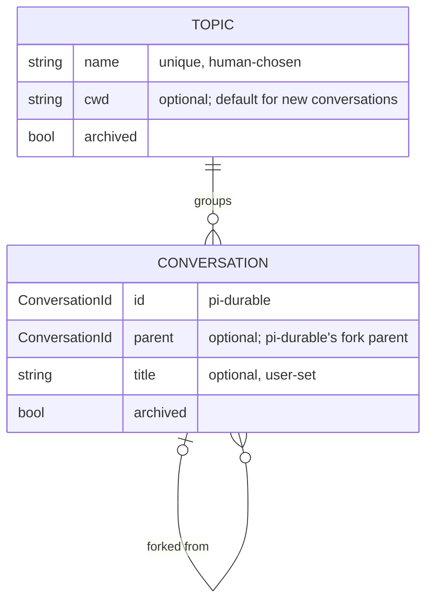

# RFC-002: Many conversations per daemon: topics and conversations

## Context

### Status of this document

Open. The user accepted the proposed decisions in principle on 2026-10-23
(Outcome, D1–D7), pending a detailed review of this text. Until that review
the RFC asserts no canon.

Its evidence comes from reading this repo and pi-durable 1.3.0
(`node_modules/@earendil-works/pi-durable`) on 2026-10-20, SL-030 (satan) and
its research (2026-10-20/21), and satan IDE-017 (2026-10-23). An earlier draft
said the pi checkout's unreleased changes had no bearing here. That was wrong:
sleeping and background tasks (`~/.local/src/pi`, HEAD `936e5f40a`) are what
self-scheduled wakeups are built from (IDE-017), and they shape D5 and D7.

### The problem

The interactive daemon `malebolge` held exactly one conversation: the
harness's root conversation. The user wants many conversations, and many
topics to group them under:

- **n topics:** separate lines of work (a project, an area of life, a question
  being chewed on).
- **n conversations per topic:** fresh starts, side threads and forks within a
  topic, without losing the earlier ones.
- **Open one from anywhere:** for example, a nushell function that opens or
  resumes a conversation for the current directory or a named topic.

### Where the single-conversation assumption lived

It was shallow. pi-durable's harness already supports many conversations, and
`satan-runner` keeps one ownerless conversation per job in a single store
(`src/runner/conversations.ts`). The daemon hard-coded "the one" in these
places:

| Layer | Site | Assumption |
|---|---|---|
| Session | `src/session.ts:15-44` | `Session = { harness, root }`. Only `harness.root()` is opened and configured. |
| Socket | `src/daemon.ts:46,52,70` | Every connection binds to `root` and runs `watchEvents(root.id)`. |
| Protocol | `src/protocol.ts:11-14` | `ClientMessage` (`input`, `abort`, `compact`) has no conversation id. There is no list, create or select message. |
| Line client | `src/attach.ts:13-30` | `/abort`, `/compact` and `/quit`. Nothing to choose or create a conversation. |
| Emacs | `emacs/malebolge.el:32,47` | One fixed `*malebolge*` buffer. |
| Prompt sections | `src/cwd.ts`, `src/daemon-start.ts:70` | The working-directory section and the project context (the instruction files found from the working directory up to the git root) are closures over the daemon's startup directory, read once. |

This table is historical (line numbers are as of 2026-10-20):

- **SL-030 (satan, 2026-10-21)** threaded the conversation through every row
  except Emacs: `src/conversations.ts`, the `attach` first frame, and a
  per-conversation `cwd` in the working-directory section. Project context
  stays daemon-wide until D2 lands.
- **SL-001 (2026-10-23)** improved the Emacs session (multi-line input,
  roles, notices), still against one buffer.
- **SL-002 (in flight)** adds a `list` frame returning bare ids,
  `malebolge-attach --list`, and a target for `M-x malebolge-attach`.

These are per-profile, not per-conversation, and stay as they are: the
instance lock, the socket, `session.sqlite`, the persona, skills and SATAN
tools.

### What pi-durable gives us (read in 1.3.0, citations in `dist/`)

- **Per-conversation agent configuration.** `Conversation.configure` stores
  `AgentChange` (model, thinking level, extensions, tools, instructions and
  `cwd`) in the `pi.agent` document, scope `conversation`, forked as of the
  fork point (`harness/agent.js:23-31`).
- **The working directory reaches the environment.** The `env` hook gets
  `EnvTarget { conversationId, cwd? }` (`harness/harness.js:136-143`).
  Malebolge's hook already uses it (`daemon-env.ts:114,136`).
- **Sections see their conversation.** `render(input, context)` receives
  `conversationId`, `agent.cwd`, `env`, and a document reader
  (`harness/types.d.ts:273-290`).
- **Per-conversation choice of extensions and tools, by name only.** The
  registry is one per harness (`harness/types.d.ts:522`).
- **Session-scoped documents** (`scope: "session"`) are shared by the whole
  store and not copied by forks (`documents.d.ts:9-31`). They are the natural
  home for an application index.
- **No conversation listing on the public `Harness`.** Enumeration is
  `tx.scanConversations({ownerTaskId?, ownerConversationId?}, limit)` inside a
  commit. Nothing filters by fork parent.
- **No metadata.** `ConversationRecord` is `{ id, parent?, owner? }`, with no
  title or label (`types.d.ts:264-275`). No conversation can be deleted.
- **Unbounded concurrency.** Different conversations run generations
  concurrently. No setting caps it (`harness/scheduler.js:994-1080`).
- **`watchEvents` covers one conversation per stream.** Events do not carry
  the conversation id (`harness/events.d.ts:184`).
- **Forks.** `Conversation.fork(at, {ownership, agent?, init?})` inherits the
  transcript up to `at` and the agent as of `at`.
- **Sleeping and background tasks** (pi HEAD `936e5f40a`, per satan IDE-017;
  not re-read here). `TaskRuntime.sleepUntil` durably sleeps a task step, and
  the deadline survives reopens. A conversation-owned background task does
  not make its conversation busy. So a task, not only a client, can start
  turns, fork, or create conversations.

## Discussion

### Model



- A **conversation** is a pi-durable ownerless conversation that belongs to
  exactly one topic, whoever created it: a client, a fork, or a task (D7).
- A **topic** is malebolge's own grouping. pi-durable has no such concept.
  A topic is a name with an optional working directory (D1). It carries no
  other agent defaults (D3).
- **Archive, not delete.** pi-durable cannot delete a conversation, so
  archiving only hides it from listings.

### Topic identity: three positions

- **T-1. A name only.** The simplest option. Opening a topic from a directory
  then means naming it every time.
- **T-2. Derived from the working directory** (the git root is the topic).
  Opening from anywhere needs no arguments. But it conflates "where the tools
  run" with "what this is about": a topic about cooking, or a topic that spans
  three repos, has no directory. The user doubts that binding conversations
  to a directory makes sense in general.
- **T-3. Named, with an optional working directory** (chosen, D1). A topic is
  named. If it has a working directory, a new conversation in the topic is
  created with it and its project context. Opening from a directory is a
  client-side lookup: the topic whose directory is this git root, otherwise a
  prompt to create one. This gives T-2's convenience without making the
  directory the identity, and T-1 is just a topic with no directory.

The topic's directory is a **creation-time default**, the same rule SL-030
applied to the model (satan DEC-104): it is copied into a conversation when
the conversation is created, and the conversation's stored `cwd` is the
authority from then on. Changing a topic's directory never rewrites existing
conversations.

A topic could also carry other agent defaults (model, extensions), applied
through `configure` at creation. It does not, for now (D3). The same
creation-time rule makes that cheap to add later.

### Where the index lives

- **I-1. A session-scoped document in the same pi-durable store** (chosen).
  Created conversations are recorded in one place, in the same commit that
  creates them, so there is never a conversation the index lacks. A single
  document (or a document family plus a key list) is small at personal scale.
- **I-2. A separate SQLite table owned by malebolge** (the runner pattern).
  It can be queried with SQL, but it is a second source of truth beside the
  store, with no atomic creation. That is not worth it at this size.

**Invariant (D7):** every ownerless conversation is in the index, whoever
created it. A conversation is added in the commit that creates it, through
`createConversation`'s `init` or `fork`'s `init`. A fork joins its parent's
topic and records the parent. pi-durable already stores `parent`, so this
costs nothing now, while retrofitting it once forks exist would mean
migrating the index.

`scanConversations` serves as a consistency check and a one-time backfill.
It finds conversations the index lacks: root, and the conversations created
through SL-030's topic-less `attach new` before the index existed. These join
the `default` topic. SL-002's interim `list` scans the store and returns bare
ids. Once the index lands, `list` reads the index.

### Prompt sections become per-conversation

- **The working-directory section** renders `input.agent.cwd` (shipped,
  SL-030). It is omitted when the conversation has no directory.
- **Project context** (D2) is read when the conversation is created, or on an
  explicit reload. It is stored in a conversation-scoped document, forked as
  of the fork point, and the section renders that document. Rendering stays
  deterministic, so prompt caching still works, and it survives restarts.
  Unlike reading during render, a room outage at render time cannot silently
  serve stale text. Today an edit to a context file needs a daemon restart;
  under this design it needs a reload of that conversation.

D2 is required by D1, not just compatible with it. Since SL-030, a
conversation created with another `cwd` runs its tools there but is given the
daemon's project context (SL-030 research X-6). Topics with their own
directories would make that the common case.

### Wire protocol

One connection serves one conversation, and a connection's first message
says what it is for:

```
client → daemon
  {type:"attach", conversation: id}                  watch + submit, as today
  {type:"attach", topic: name, new?: true, cwd?: path} latest live conversation in topic, or a new one
  {type:"list", topic?: name, archived?: bool}        → one reply, then close
  {type:"topic", name, cwd?: path}                    create/update → reply, then close
  {type:"title"|"archive", conversation: id, ...}     → reply, then close
  then, on an attached connection: input | abort | compact | fork {at?}
```

- **Compatibility:** if the first message is `input`, `abort` or `compact`,
  the connection attaches to root, which is the `default` topic's first
  conversation. Existing clients and the existing store keep working.
- **Shipped mechanism (SL-030, 2026-10-21):** `{type:"attach"}` (root),
  `{type:"attach", conversation:N}` and `{type:"attach", new:true, cwd?:S}`
  are live, answered by `{type:"attached", conversation:N}` before the
  snapshot. A first line that is a command binds root, as sketched.
- **In flight (SL-002):** `{type:"list"}` with no filters, answered with bare
  ids, then close. `topic` and `archived` filters arrive with the index.
- **Still proposals:** `attach` by topic, `topic`, `title`, `archive`, and
  `fork` (deferred, D5).
- **One stream per connection** fits `watchEvents`, which has no multiplexing
  and does not tag events with the conversation id. A client showing several
  conversations opens several connections.
- **Alternative considered:** one multiplexed connection with every event
  tagged by conversation. It is fewer sockets, but the fan-in, tagging and
  ordering would all be written in malebolge, for no user-visible gain.

SL-002 notes that `list` is the second frame valid only as a first line. A
third (`topic`, `title`, `archive`) argues for one split between first-line
verbs and attached-connection verbs in `firstLine`, rather than another
branch. The topics slice should make that split.

### Clients

- **`malebolge-attach`** has `--conversation ID` and `--new [--cwd DIR]`
  (SL-030), and gains `--list` (SL-002). The topics work adds `--topic NAME`
  and `--here` (resolve the topic by git root), and widens `--list` to topics
  and conversations.
- **nushell:** a function wraps `malebolge-attach --here` (or `--topic`). Its
  shape follows directly from the flags above.
- **Emacs:** SL-002 adds a target prompt over bare ids. With topics: one
  buffer per conversation, `*malebolge: TOPIC/TITLE*`, and a
  `completing-read` picker over `list`.
- **Listing labels** (D4): a conversation's title if it has one, otherwise a
  label derived at read time and never stored. That is the latest IDE-017
  intent entry if there is one, otherwise an excerpt of the first user
  message.

### Shared resources

- **Concurrency and cost** are handed off to satan IMP-053 (D6). The
  interactive daemon has no ceilings, and three sources start turns nobody
  types: parallel conversations, `harness.resume()` restarting every
  unfinished turn at startup, and IDE-017 wakeups, whose overdue deadlines
  all fire when the daemon restarts after downtime. One bound covers all
  three. Its owner is an ADR-017 §3 ledger row (each piece of authority has
  one owner), which is a satan governance question, not a question about how
  conversations are organised.
- **The room connection** (answered, ex-OQ-4). One pi-env connection serves
  every conversation's tool calls. SL-030 research X-4: one conversation
  already makes parallel tool calls over it (`toolExecution: "parallel"` is
  the default), and pi-env multiplexes requests by id, with each request
  carrying its own `cwd` and abort signal. That last part is a researcher
  claim nobody re-checked. The environment id `pi-env:daemon-room` must stay
  the same for every conversation, because pi-durable serializes file writes
  by environment id and path. Room fault reporting stays per daemon (satan
  DEC-106).
- **SATAN tools refresh** (`beforeInput`) is already coalesced and works
  across the whole registry. Many conversations change nothing there.

### Out of scope

The runner, per-conversation persona or skills, multiple users, and
concurrency and cost ceilings (IMP-053).

## Outcome

Accepted in principle by the user on 2026-10-23, pending detailed review.

| # | Decision | Rationale |
|---|---|---|
| D1 (OQ-1) | **T-3:** a named topic with an optional `cwd`, used as a creation-time default. `--here` is a client-side lookup from git root to topic. | Opening from a directory stays convenient, but the directory is not the topic's identity, so topics without a directory (or spanning several) are ordinary. Matches DEC-104's creation-time rule. |
| D2 (OQ-7) | **Project context is captured per conversation at creation**, kept in a conversation-scoped document, with an explicit reload. | D1 makes a conversation's `cwd` differ from the daemon's the common case (X-6). Capture keeps rendering deterministic and survives restarts. A new conversation always gets fresh context. |
| D3 (OQ-2) | **A topic carries only `cwd`.** No model or extension defaults yet. | Nothing needs them yet. The creation-time rule makes them cheap to add. |
| D4 (OQ-5) | **Titles are user-set and optional.** With no title, the listing derives a label at read time: the latest intent entry, or the first user message. | No model call and no stored state, and listings are still readable. Generated titles can come later. |
| D5 (OQ-6) | **Fork as a client verb waits.** Whether a conversation created by a task (IDE-017) is ownerless or task-owned is IDE-017's call. Leaning ownerless. | No client needs fork yet. An ownerless conversation is listed and attachable, which suits IDE-017's goal that the user can review autonomous time. A task-owned one is hidden, like the runner's, and refused at attach (satan DEC-105). |
| D6 (OQ-3) | **Concurrency and cost ceilings go to satan IMP-053**, which IDE-017 depends on. | Three unattended sources need one bound, owned by a ledger row. That is authority, not organisation. |
| D7 | **Index invariant:** every ownerless conversation is in the index, whoever created it, added in its creating commit. A fork joins its parent's topic and records the parent. Conversations from before the index are backfilled into `default`. | Tasks will create and fork conversations (IDE-017). Recording `parent` now is free; adding it later means a migration. |
| — (OQ-4) | **Answered:** the shared room connection already carries parallel tool calls (X-4). | See Shared resources. |

Next, in order:

1. SL-002 (in flight): `list` returning bare ids, Emacs target.
2. Topics and the index (I-1, D1, D3, D7), including the split between
   first-line verbs and attached-connection verbs, and `--topic`/`--here`.
3. Per-conversation project context (D2).
4. Clients: the nushell wrapper, the Emacs picker and buffer per
   conversation, and listing labels (D4).

IMP-053 and IDE-017 proceed on the satan side, independently of this order.

## References

- RFC-001: the shared room kernel. The room connection is shared by
  conversations.
- IMP-002: structure work separating the interactive program. This RFC grows
  that program's surface.
- SL-001 (Emacs session UX) and SL-002 (list and Emacs target).
- satan SL-030 and its research (`~/dev/satan/.doctrine/slice/030/research/`),
  findings X-4 and X-6; satan DEC-104 to DEC-109.
- satan IDE-017 (self-scheduled wakeups) and IMP-053 (interactive daemon
  ceilings).
- `src/runner/conversations.ts`: an existing many-conversation use of the same
  harness.
- pi-durable 1.3.0 `dist/harness/types.d.ts`, `dist/types.d.ts` and
  `dist/documents.d.ts`; checkout `~/.local/src/pi`, `packages/durable`.
