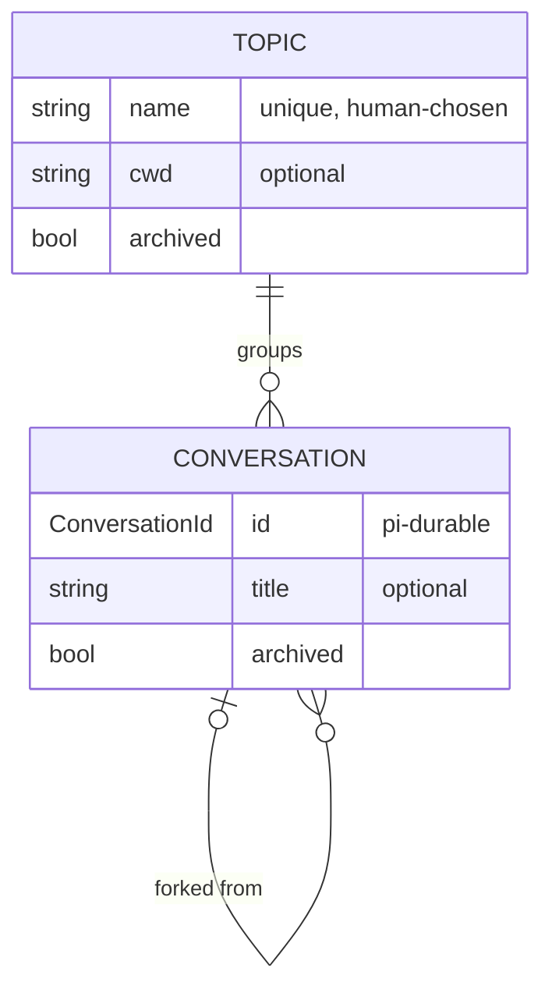

# RFC-002: Many conversations per daemon: topics and conversations

## Context

### Status of this document

Open deliberation. It asserts no canon. Its evidence comes from reading this
repo and pi-durable 1.3.0 (`node_modules/@earendil-works/pi-durable`) on
2026-10-20. The pi checkout's unreleased changes (`~/.local/src/pi`, HEAD
`482c1381a`) add nothing that bears on this RFC: sleeping tasks, the
crash-loop guard, and models and settings accepted as functions.

### The problem

The interactive daemon `malebolge` holds exactly one conversation: the
harness's root conversation. The user wants many conversations, and many
topics to group them under:

- **n topics:** separate lines of work (a project, an area of life, a question
  being chewed on).
- **n conversations per topic:** fresh starts, side threads and forks within a
  topic, without losing the earlier ones.
- **Open one from anywhere:** for example, a nushell function that opens or
  resumes a conversation for the current directory or a named topic.

### Where the single-conversation assumption lives

It is shallow. pi-durable's harness already supports many conversations, and
`satan-runner` keeps one ownerless conversation per job in a single store
(`src/runner/conversations.ts`). The daemon hard-codes "the one" in these
places:

| Layer | Site | Assumption |
|---|---|---|
| Session | `src/session.ts:15-44` | `Session = { harness, root }`. Only `harness.root()` is opened and configured. |
| Socket | `src/daemon.ts:46,52,70` | Every connection binds to `root` and runs `watchEvents(root.id)`. |
| Protocol | `src/protocol.ts:11-14` | `ClientMessage` (`input`, `abort`, `compact`) has no conversation id. There is no list, create or select message. |
| Line client | `src/attach.ts:13-30` | `/abort`, `/compact` and `/quit`. Nothing to choose or create a conversation. |
| Emacs | `emacs/malebolge.el:32,47` | One fixed `*malebolge*` buffer. |
| Prompt sections | `src/cwd.ts`, `src/daemon-start.ts:70` | The working-directory section and the project context (the instruction files found from the working directory up to the git root) are closures over the daemon's startup directory, read once. |

As of 2026-10-21 this table is historical. SL-030 (satan) threaded the
conversation through every row except Emacs: `src/conversations.ts`, the
`attach` first frame, and a per-conversation `cwd` in the prompt section.
Project context stays daemon-wide (OQ-7).

These are per-profile, not per-conversation, and stay as they are: the
instance lock, the socket, `session.sqlite`, the persona, skills and SATAN
tools.

### What pi-durable gives us (read in 1.3.0, citations in `dist/`)

- **Per-conversation agent configuration.** `Conversation.configure` stores
  `AgentChange` (model, thinking level, extensions, tools, instructions and
  `cwd`) in the `pi.agent` document, scope `conversation`, forked as of the
  fork point (`harness/agent.js:23-31`).
- **The working directory reaches the environment.** The `env` hook gets
  `EnvTarget { conversationId, cwd? }` (`harness/harness.js:136-143`).
  Malebolge's hook already uses it (`daemon-env.ts:114,136`).
- **Sections see their conversation.** `render(input, context)` receives
  `conversationId`, `agent.cwd`, `env`, and a document reader
  (`harness/types.d.ts:273-290`).
- **Per-conversation choice of extensions and tools, by name only.** The
  registry is one per harness (`harness/types.d.ts:522`).
- **Session-scoped documents** (`scope: "session"`) are shared by the whole
  store and not copied by forks (`documents.d.ts:9-31`). They are the natural
  home for an application index.
- **No conversation listing on the public `Harness`.** Enumeration is
  `tx.scanConversations({ownerTaskId?, ownerConversationId?}, limit)` inside a
  commit. Nothing filters by fork parent.
- **No metadata.** `ConversationRecord` is `{ id, parent?, owner? }`, with no
  title or label (`types.d.ts:264-275`). No conversation can be deleted.
- **Unbounded concurrency.** Different conversations run generations
  concurrently. No setting caps it (`harness/scheduler.js:994-1080`).
- **`watchEvents` covers one conversation per stream.** Events do not carry
  the conversation id (`harness/events.d.ts:184`).
- **Forks.** `Conversation.fork(at, {ownership, agent?, init?})` inherits the
  transcript up to `at` and the agent as of `at`.

## Discussion

### Model



- A **conversation** is a pi-durable ownerless conversation that belongs to
  exactly one topic.
- A **topic** is malebolge's own grouping. pi-durable has no such concept.
  At minimum a topic is a name. Whether it also carries agent defaults is open
  (positions T-1 to T-3 below).
- **Archive, not delete.** pi-durable cannot delete a conversation, so
  archiving only hides it from listings.

### Topic identity: three positions

- **T-1. A name only.** The simplest option. Opening a topic from a directory
  then means naming it every time.
- **T-2. Derived from the working directory** (the git root is the topic).
  Opening from anywhere needs no arguments. But it conflates "where the tools
  run" with "what this is about": a topic about cooking, or a topic that spans
  three repos, has no directory. The user doubts that binding conversations
  to a directory makes sense in general.
- **T-3. Named, with an optional working directory** (proposed). A topic is
  named. If it has a working directory, its conversations are configured
  with it and its project context. Opening from a directory is a client-side
  lookup: the topic whose directory is this git root, otherwise a prompt to
  create one. This gives T-2's convenience without making the directory the
  identity, and T-1 is just a topic with no directory.

A further step, not proposed now: a topic could carry other agent defaults
(model, extensions), applied through `configure` when a conversation is
created. pi-durable supports this. Defer it until it is needed.

### Where the index lives

- **I-1. A session-scoped document in the same pi-durable store** (proposed).
  Created conversations are recorded in one place: `createConversation`'s
  `init` writes the conversation into the index in the same commit, so there
  is never a conversation the index lacks. A single document (or a document
  family plus a key list) is small at personal scale.
- **I-2. A separate SQLite table owned by malebolge** (the runner pattern).
  It can be queried with SQL, but it is a second source of truth beside the
  store, with no atomic creation. That is not worth it at this size.

Either way, `scanConversations` serves only as a consistency check (it can
find conversations the index lacks, such as root). Listing reads the index.

### Prompt sections become per-conversation

- **The working-directory section** renders `input.agent.cwd`. It is omitted
  when the conversation has no directory.
- **Project context** is read when the conversation is created (or on an
  explicit reload). It is stored in a conversation-scoped document, forked as
  of the fork point, and the section renders that document. Rendering stays
  deterministic, so prompt caching still works, and it survives restarts.
  Unlike reading during render, a room outage at render time cannot silently
  serve stale text. Today an edit to a context file needs a daemon restart;
  under this design it needs a reload of that conversation.

### Wire protocol

One connection serves one conversation, and a connection's first message
says what it is for:

```
client → daemon
  {type:"attach", conversation: id}                  watch + submit, as today
  {type:"attach", topic: name, new?: true, cwd?: path} latest live conversation in topic, or a new one
  {type:"list", topic?: name, archived?: bool}        → one reply, then close
  {type:"topic", name, cwd?: path}                    create/update → reply, then close
  {type:"title"|"archive", conversation: id, ...}     → reply, then close
  then, on an attached connection: input | abort | compact | fork {at?}
```

- **Compatibility:** if the first message is `input`, `abort` or `compact`,
  the connection attaches to root, which is the `default` topic's first
  conversation. Existing clients and the existing store keep working.
- **Shipped mechanism (SL-030, 2026-10-21):** `{type:"attach"}` (root),
  `{type:"attach", conversation:N}` and `{type:"attach", new:true, cwd?:S}`
  are live, answered by `{type:"attached", conversation:N}` before the
  snapshot. A first line that is a command binds root, as sketched. `topic`,
  `list`, `title`, `archive` and `fork` remain proposals.
- **One stream per connection** fits `watchEvents`, which has no multiplexing
  and does not tag events with the conversation id. A client showing several
  conversations opens several connections.
- **Alternative considered:** one multiplexed connection with every event
  tagged by conversation. It is fewer sockets, but the fan-in, tagging and
  ordering would all be written in malebolge, for no user-visible gain.

### Clients

- **`malebolge-attach`** gains `--topic NAME`, `--new`, `--conversation ID`
  and `--here` (resolve the topic by git root). A `ls` mode prints topics and
  conversations.
- **nushell:** a function wraps `malebolge-attach --here` (or `--topic`). Its
  shape follows directly from the flags above.
- **Emacs:** one buffer per conversation, `*malebolge: TOPIC/TITLE*`, and a
  `completing-read` picker over `list`.

### Shared resources that need a decision

- **Concurrency.** pi-durable will run every busy conversation at once, and
  the interactive daemon has no ceilings, unlike the runner. A per-daemon
  limit on concurrent runs (submit waits behind it) bounds cost and gateway
  load. Its default is open (OQ-3).
- **The room connection.** One pi-env connection serves every conversation's
  tool calls. Whether concurrent calls on it are safe and fair has not been
  checked (OQ-4). RFC-001's shared room kernel is where that answer would
  live.
- **SATAN tools refresh** (`beforeInput`) is already coalesced and works
  across the whole registry. Many conversations change nothing there.

### Out of scope

The runner, per-conversation persona or skills, and multiple users.

## Outcome

Open. Proposed: T-3 (named topics, optional working directory), I-1 (index
in a session-scoped document), one conversation per connection with a
compatible default to root, and project context captured per conversation.

Open questions:

- **OQ-1.** Topic identity: T-3, or is T-1 enough, with directory lookup
  living only in the nushell function?
- **OQ-2.** Should a topic carry agent defaults beyond the working directory
  (model, extensions), or only the directory?
- **OQ-3.** The concurrent-run limit: 1 (only one conversation thinks at a
  time; simple and cheap) or small n? Should the interactive daemon get cost
  ceilings like the runner's?
- **OQ-4.** Is one pi-env room connection safe for concurrent tool calls from
  several conversations?
- **OQ-5.** Titles: user-set only, or generated by a cheap model after the
  first exchange?
- **OQ-6.** Should fork be a first-class client verb now, or wait?
- **OQ-7.** Project context freshness: is reloading on demand enough, or
  should a new conversation always re-read it?

## References

- RFC-001: the shared room kernel. The room connection is shared by
  conversations (OQ-4).
- IMP-002: structure work separating the interactive program. This RFC grows
  that program's surface.
- `src/runner/conversations.ts`: an existing many-conversation use of the same
  harness.
- pi-durable 1.3.0 `dist/harness/types.d.ts`, `dist/types.d.ts` and
  `dist/documents.d.ts`; checkout `~/.local/src/pi`, `packages/durable`.
