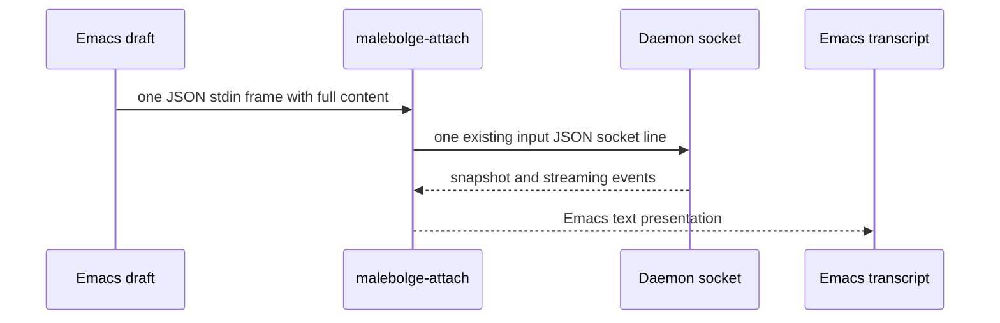

<!-- doctrine:section sec-1 -->
## Purpose and boundary

SL-001 changes the Emacs conversation surface so a person can write a draft containing newlines, submit it once, and keep reading while Satan streams a reply. The daemon already accepts `input.content` as a string and passes it to the conversation; the split occurs when the attach client treats each stdin line as a separate input ([research](research/research.md), Thread 2; `src/protocol.ts:19`, `src/attach.ts:260`). The existing daemon socket message and conversation semantics stay in place.

The Emacs session has two buffers: a read-only comint transcript attached to the process, and an editable draft buffer tied to that transcript. The attach client selects a private Emacs stdin mode and a matching text presentation profile. Its terminal default remains one typed line per input.

The diagram shows two separate framing boundaries. The draft's embedded newlines are escaped within one JSON line on stdin, then within one JSON line on the daemon socket. The socket protocol does not gain a message type. The transcript displays events; it does not own conversation state. Decisions: DEC-001 through DEC-005.
<!-- doctrine:section sec-2 -->
## Emacs interaction

`malebolge-attach` continues to own the process-backed comint transcript. It opens or reuses a companion `*malebolge-draft*` buffer in a dedicated draft mode. The draft is ordinary editable text: `RET` inserts a newline, paste leaves all lines in place, and incoming process output is inserted only in the transcript. The draft buffer is retained when the attach process exits or the transcript is reattached. Reattachment reconnects the same transcript and restores its companion draft; a dead process never consumes a draft.

In the draft, `C-c C-c` submits the exact buffer text as one input. Only an all-whitespace draft is refused. Newlines, blank interior lines, leading spaces, trailing spaces, and text beginning with `/` are preserved. Validate that the attach process is live before sending; on failure leave the draft intact and show a clear Emacs error. The submit command writes its JSON frame directly with `process-send-string`, bypassing comint's ordinary input sender. After a successful local write, clear the draft and leave focus in it. The daemon's user event supplies the transcript echo, so the editor must not append a second conversation turn locally. A local minibuffer message may acknowledge the write, but it does not claim daemon acceptance.

Both buffers advertise their local actions in a concise header line and through `C-c C-h` help. `C-c C-e` opens/focuses the draft from the transcript. `C-c C-a` sends the equivalent of `/abort`; `C-c C-m` prompts for optional `/compact` instructions; `C-c C-q` performs `/quit` and detaches. The controls are available while a draft is nonempty and never clear it. Typed slash text in a draft is message content; the named key commands are the Emacs route to those actions. Terminal users retain the existing slash command syntax (`src/attach.ts:94`). These bindings are buffer-local and do not affect other comint modes.

The transcript is for reading and command shortcuts. Set it read-only for ordinary edits, bind `RET` there to focus the draft, and install a buffer-local `comint-input-sender` that refuses any `comint-send-input` call without writing to process stdin. This last guard covers alternate comint bindings and programmatic calls as well as `RET`. The comint process marker and output filter still receive attach output under the required internal write allowance. The draft buffer has no process filter and never receives streamed text.
<!-- doctrine:section sec-3 -->
## Input and attach-client contract

`src/attach.ts` extends its existing strict `parseAttachArgs` option table with `--emacs`. A single exported invocation parser derives both the target and the mode from that parse; the existing `attachTargetOf` may delegate to it for compatibility. `src/attach-main.ts` consumes that one parsed invocation and passes `inputMode: "frames"` and `presentation: "emacs"` to `attach` when the flag is present. Existing invocations default to typed-line mode and the current terminal presentation. The flag composes with `--conversation` or `--new --cwd`; strict validation still fails before connecting. `emacs/malebolge.el` adds the option to the attach command it starts, rather than relying on an environment variable or terminal detection.

In frame mode, one physical stdin line is one private client frame. Emacs JSON-serializes the action and appends exactly one line terminator. For a draft containing an actual newline, the frame's JSON text is `{"type":"input","content":"first\nsecond"}` followed by one physical newline; parsing restores the newline in `content`. Accepted frame shapes are the existing daemon commands `input`, `abort`, and `compact`, plus client-local `{"type":"quit"}`. `quit` closes the attach connection and is never sent to the daemon. The frame parser rejects malformed JSON, unknown types, wrong field types, and unexpected fields with a visible client notice; it neither forwards nor converts a refused frame into input. Frame mode does not interpret slash-prefixed message content as commands.

The attach client reuses `handleTyped`'s existing hold-until-attached and `encodeLine` socket path after validation (`src/attach.ts:169`, `src/attach.ts:210`). One draft frame must yield exactly one `{type:"input", content:<unchanged draft>}` socket message. The daemon's `ClientMessage` type and parser remain unchanged (`src/protocol.ts:19`, `src/protocol.ts:120`); the daemon sees no Emacs-specific frame. EOF and quit retain the current detach behavior. The default line mode keeps `commandOf` and its current blank-line and slash-command semantics.

Frame-mode errors are client notices, not daemon errors. Input is not silently truncated, trimmed, or split. The implementation should avoid duplicating protocol validation rules: parse the existing three daemon message types with the existing parser, then apply the stricter private stdin field check and handle quit locally.
<!-- doctrine:section sec-4 -->
## Transcript presentation

`createRenderer` gains a small presentation option; its default output stays compatible with the terminal client (`src/render.ts:1`). The Emacs profile renders a user turn as a `You:` heading followed by its exact content, and visible assistant text as a `Satan:` heading followed by its content. Headings occupy their own lines, so multiline content needs no per-line rewriting and remains readable without color. The profile renders live user `message_end` events as well as snapshot user entries; this supplies one conversation echo for drafts and also shows turns submitted by another attached client. The editor does not inject user turns. The profile labels daemon notices as `[status] ...` and tool activity as `[tool] ...`; optional Emacs faces may add emphasis, but the literal labels carry the distinction.

The attach client creates the renderer before connecting and sends its own connection, detach, connection failure, early close, version skew, and malformed-frame notices through that renderer as client-local notice events (`src/attach.ts:154`, `src/attach.ts:177`, `src/attach.ts:230`, `src/attach.ts:290`). They are never sent to the daemon. The renderer formats them as `[status] ...` in Emacs mode and retains their current terminal text by default. Routing them through the same stateful renderer means a notice arriving during an answer also triggers the continuation handling below.

The assistant heading is lazy: `message_start` or a snapshot generation with no visible text prints no heading. The first visible text delta or partial snapshot text prints one `Satan:` heading before the content. A completed empty or thinking-only assistant message prints neither a heading nor a separator. A reattached partial answer with visible text gets one heading and continues from its snapshot text without duplicating it. This follows the snapshot/stream split in `src/render.ts:164` through `src/render.ts:181`.

A completed nonempty Satan response ends with at least two newline characters after its body: one terminates the final content line and one creates a blank separator. The renderer adds only the missing newline characters when the answer already ends in newlines. The same completion rule applies to a snapshot assistant entry and a live `message_end`; an answer still in flight gets no completion separator until it ends.

A status, tool, or client-local notice can arrive while answer text is streaming. In the Emacs profile, the renderer starts such a notice on a fresh line and resumes later answer text under a textual `Satan (continued):` cue if any answer text was already visible. A whole-block replacement that cannot overwrite already printed text starts a `Satan (revised):` continuation. These cues prevent a notice or rewritten chunk from looking like part of the assistant's prose while keeping output append-only. Snapshot history renders the final answer as one `Satan:` block. The display differences are intentional; the content and completion separator are the same.

Every distinction must remain obvious in a monochrome buffer or copied plain text. An Emacs regexp does not reconstruct role boundaries from a flat stream; the event-aware renderer supplies them.
<!-- doctrine:section sec-5 -->
## Output following and reattachment

The draft buffer never receives process output and keeps its point and active window while Satan responds. In the transcript, `comint-scroll-to-bottom-on-output` is disabled locally. A buffer-local preoutput hook records, for each window displaying that transcript, whether the old end of the transcript was visible before insertion. A paired postoutput hook moves only those qualifying windows to the new end. A window reading older text keeps the same logical text at its window start and point. The rule is per window, so a second window at the bottom may follow while the selected window remains on older content. Output never selects a window or moves focus out of the draft.

The transcript's process marker remains comint's insertion point. The follow hooks observe window state around output insertion; they do not edit streamed text, parse daemon events, or change other comint buffers. A user who scrolls away stops following on the next chunk; returning to the bottom resumes following on the next chunk.

A live `malebolge-attach` call reuses its transcript and draft. When the old process is dead, Emacs first clears only the derived transcript under an internal write allowance, then calls `make-comint-in-buffer` to start the replacement attach process. The clear occurs before any new process output can arrive; the daemon's snapshot repopulates the transcript once. The draft buffer is never cleared by reattachment. If process creation or connection fails, show a status/error in the cleared transcript and retain the draft for another attempt. `/quit` detaches only; it does not stop the daemon or discard a draft.
<!-- doctrine:section sec-6 -->
## Code impact and verification

| Surface | Intended change |
| --- | --- |
| `emacs/malebolge.el` | Add the companion draft mode, direct framed submit and control commands, transcript input guard, local help/header cues, reattach clearing, and buffer-local conditional follow hooks. Start the attach process with `--emacs`. |
| `src/attach-main.ts` | Consume the one strict invocation parser and pass the selected input and presentation modes to `attach`. |
| `src/attach.ts` | Extend its strict CLI parser with `--emacs`; parse private JSON stdin frames, reject malformed frames visibly, keep local quit and held-command behavior, and route client-local notices through the selected renderer. Preserve default typed-line behavior. |
| `src/render.ts` | Add the Emacs profile's lazy headings, live user echo, event and client notice labels, streaming continuation cues, and completed-answer separator in both snapshot and live paths. |
| `test/attach.test.ts`, `test/render.test.ts`, `test/malebolge-ert.el`, `test/emacs-attach-smoke.ts` | Exercise parsing, presentation, Emacs commands/windows, and the full Emacs-to-attach-to-socket boundary. |
| `src/protocol.ts`, daemon/session code | No planned change; current `input.content` carries the full draft. |

Focused attach tests must show that an Emacs frame containing leading and trailing spaces, an interior blank line, and a slash-leading line produces exactly one socket `input` with identical content. They must also cover `--emacs` combined with target flags, abort, compact with and without instructions, local quit that never reaches the socket, pre-attach holding, malformed frames that send nothing, profile-specific client notices, and unchanged default typed-line behavior.

Renderer tests must compare live and snapshot formatting for the same completed user/assistant turns, including multiline content, answers ending with zero, one, or multiple newlines, empty and thinking-only answers, partial answers at reattach, notices during a stream, a client-local notice during a stream, and a rewritten streamed block. The Emacs profile must show one user turn per valid user event; a snapshot with an earlier user turn followed by a new live user turn shows each exactly once. The default terminal profile keeps its current output expectations.

Emacs ERT checks should use a fake attach process or captured stdin to prove `C-c C-c` writes one JSON line and clears only a live-submitted draft; `RET` and paste in the draft do not submit; `RET` and `comint-send-input` in the transcript write zero bytes; commands preserve a nonempty draft; process death retains it; and incoming output leaves the draft cursor stable. A window test should show only transcript windows previously at the old end follow a new chunk, including a selected window reading older text. Reattach checks must show one refreshed snapshot after the old transcript is cleared, with the draft preserved.

An automated local integration check in `test/emacs-attach-smoke.ts` must launch batch Emacs, the real `malebolge-attach --emacs`, and a fake daemon socket; submit a multiline draft during a streamed answer; and assert that the socket receives one input with the exact content and that no quit frame reaches it. It must then reattach and inspect completed-response spacing and role cues. An ordinary terminal attach invocation in the same check confirms its line commands. This script is a required implementation verification gate, not a manual observation. These are future checks; this design round does not execute them.
