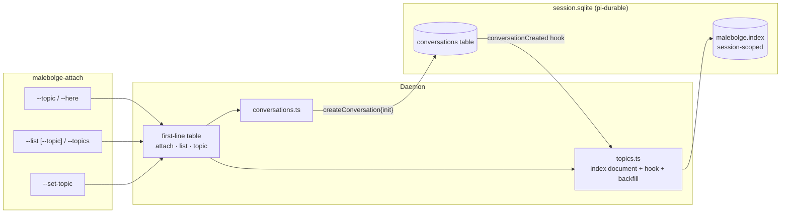

<!-- doctrine:section sec-1 -->
## Purpose and boundary

SL-003 organises the daemon's conversations into **topics**. A topic is a
unique name with an optional working directory. A **conversation index**
records which topic each ownerless conversation belongs to, and which
conversation a fork came from. Today a client can reach a conversation only by
its id (SL-002), and nothing groups conversations by what they are for.

This slice implements three of RFC-002's decisions:

- **D1:** a topic's directory is copied into a conversation at creation;
  changing the topic never rewrites existing conversations.
- **D3:** a topic carries only that directory.
- **D7:** every ownerless conversation is indexed in the commit that creates
  it; a fork joins its parent's topic; older conversations are backfilled into
  `default`.

Out of scope, per the scope's Non-Goals:

- per-conversation project context (D2);
- titles, labels and archiving (D4);
- Emacs topic support;
- fork as a client verb (D5);
- ceilings (satan IMP-053).

**Prerequisite:** CHR-002 moves the pi packages to exactly 1.4.0 first
(DEC-011). This design is written against 1.4.0. The only 1.4.0 feature it
leans on is the mandatory `checkpointWhen` on `defineDoc`.



Two properties keep the boundary honest:

- **The index cannot lag the store.** A pi-durable hook writes the index in
  every commit that creates a conversation (DEC-012), and the backfill covers
  only conversations created before this slice.
- **Every new wire shape widens additively.** New keys and a new reply type,
  never a changed element type (DEC-007's rule; DEC-016). An older daemon
  therefore refuses each new shape in a way the client can recognise.

Decisions: DEC-011 (prerequisite), DEC-012 (seam), DEC-013 (document shape),
DEC-014 (`--here`), DEC-015 (latest; `default`), DEC-016 (protocol), DEC-017
(client flags).

<!-- doctrine:section sec-2 -->
## The index: one document, one seam, one backfill

**Document (DEC-013).** A new root module, `src/topics.ts`, owns the index:

```ts
type IndexEntry = { topic: string; parent?: number };
type TopicRecord = { cwd?: string };
type IndexDoc = {
  topics: Record<string, TopicRecord>;        // `default` is never stored (DEC-015)
  conversations: Record<string, IndexEntry>;  // key: conversation id as text
};
const IndexDocument = defineDoc<IndexDoc>({
  kind: "malebolge.index", version: 1, scope: "session",
  initial: () => ({ topics: {}, conversations: {} }),
  checkpointWhen: (_value, _ops, info) => info.deltasSinceBase >= 50,
});
```

- Session scope means the whole store shares the document, and a fork never
  copies it (`dist/session/forks.d.ts:1-11`).
- Entries are objects, so D4's titles and archive flags can be added later as
  optional keys without a version bump.
- `kind` is part of the stored protocol and never changes. A shape change
  bumps `version` and supplies a `migrate`.

**Seam (DEC-012).** `openSession` (`src/session.ts:30-44`) passes
`conversationCreated: indexConversation` to `Harness.open`. pi-durable runs
the hook in every commit that creates or forks a conversation, raw
`tx.createConversation` and root included. It runs after the built-in `pi.*`
documents and before `agent` and `init`
(`durable src/harness/harness.ts:394-425`, `src/session/transaction.ts:292-345`).
`indexConversation(tx, record)`:

1. If `record.owner` is set, return: task-owned conversations are refused at
   attach and are not indexed.
2. If `record.parent` is set, look up the parent's entry in the index. Write
   `{topic: parent's topic ?? "default", parent: parent id}`.
3. Otherwise write `{topic: "default"}`.

A caller that names a topic passes `init: assignTopic(name)`, which runs
later in the same commit and overwrites `topic`. The hook only reads documents
and never reads a table, so `ReadAfterWrite` cannot fire (research F-5). A throw fails
the creating commit, so a conversation without an index entry cannot exist.

**Backfill (inq-8).** `backfillIndex(harness)` in `src/topics.ts` runs from
`openSession` after `harness.root()` and before `harness.resume()`. So it
finishes before any client is served (`conversationsReady` resolves after
`openSession`, `src/daemon-start.ts:94-113`) and before a resumed task can
create a conversation. It is one commit:

1. Page through `tx.scanConversations({order: "ascending"}, PAGE, cursor)`
   until `next` is undefined. The cursor loop follows
   `src/runner/durable-ids.ts:27-32`.
2. Then write `{topic: "default", parent?}` for every ownerless record the
   index lacks.

- All reads happen before any write, so the commit never reads after writing.
- Run again, it finds nothing missing and writes nothing.
- "Root first" is not a separate rule: root has the lowest id, and DEC-015
  orders by id.
- On a fresh store the hook has already indexed root by the time the
  backfill runs.

**Reads.** `harness.snapshot(IndexDocument, context)`
(`dist/session/session.d.ts:71`) returns the document, or `undefined` when it
has never been written: `snapshot` does not apply `initial()`, which only a
transaction's document access does (pi 1.4.0 `session.ts:305-322`). One
reader, `readIndex(harness)` in `src/topics.ts`, maps `undefined` to
`initial()`, and every topic listing goes through it. After `openSession` the
document always exists, since the hook writes it with root, so the fallback
matters only to a store opened without the hook (a pre-index store, or a
test).

<!-- doctrine:section sec-3 -->
## Topics: names, `default`, directories, latest

**Names (inq-9).** A topic name matches `^[a-z0-9][a-z0-9._-]{0,63}$`. One
validator, `topicNameOf(text)` in `src/topics.ts`, is used by the protocol
parser and by the client, so the two cannot disagree. A name that fails is
refused as `<frame>: topic must match [a-z0-9][a-z0-9._-]{0,63}`.

**`default` (DEC-015)** is reserved:

- It always exists, but is never stored in `topics`.
- It has no directory, and cannot be created or given one: `topic: default is
  reserved`.
- Root is its first conversation, and so are every conversation the backfill
  adds and every legacy `attach new`.

A plain `malebolge-attach` still binds root (README "Which conversation";
RFC-002's compatibility rule). `--topic default` binds `default`'s latest
conversation, which is root only until another conversation joins.

**Latest (DEC-015).** A topic's latest conversation is the highest id among
its index entries. No extra state is needed, since pi-durable mints ids above
every earlier one (`Storage.mintId`, 1.4.0 changelog). The lookup is a scan
over `conversations`, which is small at personal scale.

**Attaching by topic, `{type:"attach", topic, new?, cwd?}`:**

1. Read the index. If the topic is unknown (and not `default`), refuse with
   `attach: no topic <name>`. Never create a topic implicitly (DEC-016).
2. Without `new`, bind the latest conversation if there is one. If the topic
   has no conversations yet, fall through to step 3, so attaching to a fresh
   topic starts its first conversation.
3. Otherwise create one with:
   - `agent: {...defaults, cwd: client cwd ?? topic cwd ?? daemon cwd}`;
   - `init: assignTopic(name)`.

**D1 holds** because the topic's directory is read once, when the
conversation is created, and written into that conversation's own `pi.agent`.
After that, the conversation's stored cwd is the authority (satan DEC-104,
DEC-107). Changing the topic touches only `topics[name]`.

Step 1's read and step 3's creating commit are two commits. A topic change
that lands between them gives the new conversation the old directory. That is
still a creation-time default and needs no lock.

`cwd` stays an opaque string throughout (DEC-107): no resolution and no
containment check.

<!-- doctrine:section sec-4 -->
## Protocol: three first-line frames, one dispatch table

**Frames (DEC-016)**, all parsed strictly. An unknown key is a `FrameRefused`
named for its frame (`src/protocol.ts:66-92`).

| first line | reply, then | refusals (each `FrameRefused`, then close) |
|---|---|---|
| `{type:"attach"}` / `{conversation:N}` / `{new:true, cwd?}` | `attached`, snapshot, events, as shipped | as shipped |
| `{type:"attach", topic, new?, cwd?}` | `attached`, snapshot, events | `conversation and topic are exclusive`; `cwd needs new`; bad name; `no topic X` |
| `{type:"list"}` | `{type:"conversations", conversations, truncated}`, then close. Unchanged: still `scanConversations`, so it matches SL-002 on the same store | — |
| `{type:"list", topic}` | `conversations`: that topic's ids from the index, newest first, cut at `LIST_PAGE` with `truncated` | bad name; `no topic X` |
| `{type:"list", topics:true}` | `{type:"topics", profile, topics:[{name, cwd?}]}`: `default` first, then by name; then close | `topic and topics are exclusive`; `topics must be true` |
| `{type:"topic", name, cwd?: string\|null}` | `topics` with the one record written, then close | bad name; `default is reserved`; `cwd must be a string or null` |

- `topic` with `cwd` absent creates the topic, or leaves an existing one
  unchanged, so it is idempotent. A string sets the directory; `null` clears
  it.
- `attach` with `topic` and without `new` takes a `cwd` only alongside `new`,
  as it does today. A `cwd` makes sense only for a conversation being created.
- `{type:"topics", profile, topics}` is a new reply type, used both for
  writing a topic and for listing topics. `conversations` keeps its element
  type (DEC-007's rule).
- `profile` is the answering daemon's own execution profile, `"host"` or
  `"room"` (`config.execution.profile`). Topic directories are paths in that
  profile's path space, so the reply says which space its `cwd`s are in.
  `--here` relies on this (section 5): the client cannot learn the daemon's
  profile from its own environment, because `MALEBOLGE_SOCKET` can point it
  at any daemon (`src/config.ts:76-89`).
- Retired: `list: unknown key topic` (`test/daemon.test.ts:702-712`). That
  test is rewritten to assert the topic filter. A different unknown key, such
  as `{"type":"list","page":2}`, keeps the shipped refusal shape.

**The split (objective 6).** `src/protocol.ts` gives first-line frames their
own type and parser:

```ts
export type FirstLineFrame = AttachMessage | ListMessage | TopicMessage;
/** A first-line frame, parsed strictly; undefined when `type` names none. */
export function parseFirstLineFrame(message: JsonRecord): FirstLineFrame | undefined;
```

`parseConnectionMessage` becomes `parseFirstLineFrame(...) ?? parseClientMessage(line)`.
`src/daemon.ts` replaces `firstLine`'s per-verb branches (`:202-232`) with a
table:

```ts
const FIRST_LINE: { [K in FirstLineFrame["type"]]: FrameHandler<K> } = {
  attach: (state, conversations, frame) => bindTarget(state, conversations, frame.target),
  list: (state, conversations, frame) => answer(state, () => conversations.list(frame.query)),
  topic: (state, conversations, frame) => answer(state, () => conversations.setTopic(frame)),
};
```

- `answer(state, produce)` generalises `answerList` (`:185-199`): produce one
  reply, `finish` with it, and send any rejection through `fail` (DEC-007's
  "failed reads close").
- A new first-line verb becomes one parser case plus one table row. The
  mapped type makes the compiler reject a frame without a handler.
- `laterLine` (`:235-256`) keeps the shipped rule: any first-line frame on a
  bound connection, valid or refused, answers the unprefixed
  `already attached to conversation N`. The check becomes "is a
  `FirstLineFrame`" instead of naming each type.

**`Conversations` interface** (`src/conversations.ts:26-35`):

- `open(target)` gains a `{kind: "topic", name, new, cwd?}` target. It is
  routed through section 3's resolution.
- `list(query)` takes `{kind: "all"} | {kind: "topic", name} | {kind: "topics"}`.
  `all` is today's scan; the other two read the index.
- New: `setTopic({name, cwd})`, one commit on the index document.

Any of these rejects with a client-facing message. The daemon module gains no
knowledge of the index.

<!-- doctrine:section sec-5 -->
## Client: topic flags, one request-reply path, `--here`, skew

**Invocations (DEC-017).** `AttachInvocation` (`src/attach.ts:113-130`)
widens to:

```ts
type Here = { here: true };  // `--here`, unresolved until resolveHere

type AttachInvocation<T = string | Here> =
  | AttachCommand<T>                               // target may be {kind:"topic", name: T, ...}
  | { mode: "list"; wait: ConnectWait; topic?: T }
  | { mode: "topics"; wait: ConnectWait }
  | { mode: "set-topic"; wait: ConnectWait; name: string; cwd: T | null | undefined };

type ResolvedInvocation = AttachInvocation<string>;
```

| flags | invocation |
|---|---|
| `--topic NAME [--new [--cwd DIR]] [--emacs]` | attach to topic `NAME` |
| `--list [--topic NAME]` | list ids, all or one topic's |
| `--topics` | list topics as `name<TAB>cwd`, one per line |
| `--set-topic NAME [--dir PATH \| --no-dir]` | create the topic or re-point it; print the record; exit |
| `--here` | stands in for `--topic NAME` (attach or `--list`), or for `--dir` with `--set-topic` |

- **Exclusivity**, extending DEC-008 and enforced by one `checkAlone` helper
  that generalises `checkListAlone` (`:133-145`):
  - `--topic` with `--conversation`, and `--here` with `--topic` or
    `--conversation`;
  - `--topics` with every other flag;
  - `--set-topic` with every attach and list flag;
  - `--dir` with `--no-dir`, and `--here` with either.

  Each refusal is a `UsageError`, so exit 2 and the usage line.
- `USAGE` (`src/attach-main.ts:14`) names the new modes.
- Parsing stays synchronous: `attachInvocationOf` returns an
  `AttachInvocation`, with `Here` wherever `--here` stood. `attach-main.ts`
  then awaits `resolveHere` (below) and dispatches only a
  `ResolvedInvocation`, so an unresolved `--here` cannot reach a frame.

**One request-reply path.** `listConversations` (`src/attach.ts:483-577`)
already does "send one frame, ignore stray traffic, take one reply, close".
It becomes `request(socketPath, frame, replyType, errors, wait)`, which
resolves to the typed reply and prints nothing to stdout:

- traffic from an older daemon that bound root is ignored;
- a `FrameRefused`, a skew reply (below) or a close with no reply rejects;
- the caller renders. `--list`, `--topics` and `--set-topic` each send their
  frame through `request` and pass the reply to its renderer on stdout;
  everything else goes to stderr (DEC-008). `resolveHere` uses the same path
  and renders nothing.

`render.ts` gains a `topics` renderer next to `conversations`
(`src/render.ts:254`). There is no second listing client.

**`--here` (DEC-014).** `resolveHere(invocation, socketPath, gitRoot)`
returns the invocation unchanged when it holds no `Here`. Otherwise, in order:

1. `git rev-parse --show-toplevel` in the client's cwd. Not in a git repo:
   say so, exit 1, nothing sent.
2. `request` a `{type:"list", topics:true}` frame.
3. If the reply's `profile` is not `host`, refuse: `--here needs a host
   daemon: this daemon runs under room, so its topic directories are room
   paths, not this shell's`. Exit 1. The profile is the answering daemon's,
   so a `MALEBOLGE_SOCKET` override cannot get past the check in either
   direction. The client's `MALEBOLGE_PROFILE` still picks the default
   socket and nothing else.
4. With `--set-topic`, the git root is the directory. Done: no topic needs
   to match it, and other topics may already share it, since directories are
   not unique. This is how a topic first gets its directory.
5. Otherwise (attach or `--list`), collect the topics whose `cwd` equals the git root exactly:
   - one: substitute its name;
   - none: `no topic has directory <root>`, exit 1;
   - several: `topics a, b have directory <root>; name one with --topic`,
     exit 1. Topic names are unique and directories are not, so `--here`
     never picks one for the user.

In every refusal, nothing is created and no frame follows the listing.

**Skew (inq-7).** An older daemon fails a new shape in one of two ways:

- a `topic` first line is not a frame it knows, so it binds root and answers
  `unknown message type "topic"` (research F-3);
- a new key on `attach` or `list` is a strict-key refusal:
  `attach: unknown key topic` or `list: unknown key topic[s]`
  (`src/protocol.ts:83-87`).

`skewFrameOf` (`src/attach.ts:258-268`) becomes `skewOf(message)`, which
matches both shapes. It returns the feature the daemon predates: `topic`, or
`topics` for the key forms. `failBeforeAttach` (`:340-349`) and the request
path both use it, so every skew prints the restart hint.

<!-- doctrine:section sec-6 -->
## Code impact

| file | change |
|---|---|
| `src/topics.ts` (new) | `IndexDocument`; `topicNameOf`; `indexConversation` (the hook); `assignTopic(name)` (the `init`); `backfillIndex`; `readIndex` (the one snapshot read, absent → `initial()`); over it `topicsOf`, `latestIn`, `idsIn`; `setTopic` |
| `src/session.ts` | passes `conversationCreated: indexConversation` to `Harness.open`; runs `backfillIndex` after `root()`, before `resume()` |
| `src/conversations.ts` | `open` handles a topic target; `list(query)`; `setTopic`. Reads the index only through `topics.ts`. `conversations(session, defaults, profile)` takes the daemon's profile for the `topics` reply |
| `src/daemon-start.ts` | passes `config.execution.profile` to `conversations` |
| `src/protocol.ts` | `FirstLineFrame`, `parseFirstLineFrame`, `TopicMessage`, `TopicsMessage` (with `profile`); `attach` and `list` key lists widen; `AttachTarget` gains `topic` |
| `src/daemon.ts` | the `FIRST_LINE` table; `answer` generalises `answerList`; `laterLine` checks "is a first-line frame" |
| `src/attach.ts` | `Here` and the invocation union; flags; `checkAlone`; `request` (typed reply, no rendering) replaces `listConversations`; `resolveHere`; `skewOf` |
| `src/attach-main.ts` | `USAGE`; awaits `resolveHere`, then dispatches a `ResolvedInvocation` and renders each mode's reply |
| `src/render.ts` | the `topics` renderer |
| `test/topics.test.ts` (new) | the index, the hook, backfill, names, latest |
| `test/conversations.test.ts`, `test/protocol.test.ts`, `test/daemon.test.ts`, `test/attach.test.ts`, `test/render.test.ts`, `test/session.test.ts` | the matrices in section 7 |
| `test/harness-fixture.ts` | `indexOf(harness)`, a snapshot read of the index |
| `test/structure.test.ts` | only if a tier allowlist must name `topics` (it is a root module imported by root modules, so probably no change) |
| `README.md`, `docs/internals.md` | section 7 |

- `src/topics.ts` is the index's only owner, so nothing else touches
  `IndexDocument`. That keeps "the index and the store diverge" a one-file
  question.
- The daemon module still knows only `Conversations`.
- `src/runner/` is untouched. Its store is `runner.sqlite`
  (`src/runner/start.ts:65`), which has no index.

<!-- doctrine:section sec-7 -->
## Verification and documentation

**Fixtures.** `openTestHarness` goes through `openSession`, so it installs
the hook. `openFauxHarness` (`test/harness-fixture.ts:93-105`) bypasses
`openSession`, so a store it builds has no index. That is exactly a store from
before this slice: the backfill tests create conversations through it, then
reopen the same `MemoryStorage` or SQLite file through `openSession`.

Add `indexOf(harness)`, which reads through `readIndex`, to
`test/harness-fixture.ts` so tests assert on the document rather than on
internals.

The creating-commit guarantee needs one test that bypasses the backfill,
since `openSession` would repair a hook that skipped root before any test
looked. It opens a fresh store with `Harness.open` and the hook only (no
`backfillIndex`), calls `root()`, and asserts root's entry.

**Criteria**, each tied to the scope's done-when (VT = verified by test):

| criterion | how |
|---|---|
| Created and forked conversations are indexed in the creating commit; a fork records its parent's topic and its parent (D7, DEC-012) | VT, `test/topics.test.ts`: `createConversation` with and without `init`; `Conversation.fork` (the first fork test in this repo); raw `tx.createConversation` (default); a task-owned conversation (not indexed); a hook that throws fails the commit; an `init` that throws persists neither the conversation nor its entry; root indexed by the hook alone on a fresh store (hook installed, no backfill) |
| Backfill puts pre-index conversations, root included, into `default`; a second start changes nothing | VT: build with `openFauxHarness`, reopen through `openSession`, assert the entries; reopen again, assert the document's sequence did not move |
| A topic's directory reaches new conversations only (D1) | VT, `test/conversations.test.ts`: create a topic with dir A; attach new gives A; set B; the old conversation keeps A (its `agent().cwd`); a new one gets B; client `cwd` beats topic beats daemon |
| Attach by topic binds the latest, creates with `new`, starts an empty topic, refuses an unknown one | VT, `test/daemon.test.ts` over the socket |
| `readIndex` on a store whose index was never written returns `initial()` | VT, `test/topics.test.ts` over an `openFauxHarness` store |
| `list` without a filter matches SL-002's output; with `topic` returns only that topic's ids; `topics` lists `default` first and carries the daemon's `profile` | VT, `test/daemon.test.ts`. The `unknown key topic` test (`:702-712`) is rewritten, and an unknown-key refusal is kept for `page` |
| `topic` frame: create, idempotent re-create, set, clear, `default` refused, bad name refused | VT, `test/protocol.test.ts` (parse table) and `test/daemon.test.ts` (reply and close) |
| First-line split: every frame type has a handler; a bound connection refuses each with `already attached` | VT: compile-time through the mapped type; `test/daemon.test.ts` for the three frames on a bound connection |
| Client flags and exclusivity (DEC-017) | VT, `test/attach.test.ts`: the invocation table, one row per refused pair |
| `--here`: exact match against a `host` daemon; refusal when the daemon reports `room`, whatever the client's `MALEBOLGE_PROFILE` (both mismatches: profile `host` with a room daemon's socket, and an unset profile with a host daemon's socket, which succeeds); for attach and `--list`, no match and several matches each refuse; `--set-topic --here` succeeds with zero and with several existing matches, and refuses against a `room` daemon. In every refusal no frame follows the listing, and the lookup itself writes nothing to stdout | VT, `test/attach.test.ts` with a stubbed git root and a stub daemon; VH (verified by a human) once against a live `host` daemon |
| Skew: an old daemon answers each new shape with the restart hint | VT, `test/attach.test.ts`: a stub daemon answering `unknown message type "topic"`, `attach: unknown key topic` and `list: unknown key topics` |
| Live: `--topic` and `--here` against a running daemon | VH, one session, recorded in notes |
| `just check` and `just ert` green | VT |

**Documents owed:**

- `README.md`'s "Which conversation" (`:120-159`): topics, `default`,
  `--topic`, `--topics`, `--set-topic`, and `--here` as host-only, with the
  path-space reason.
- `docs/internals.md` §Protocol (`:82-147`): the first-line table rows from
  section 4, the index document, and the dispatch table.
- **Decision amendments at reconcile.** SL-002 wrote its DEC amendment this
  way; a DEC is not a REV target.
  - DEC-007: the `topic` and `topics` keys; the retired refusal; the `topics`
    reply.
  - DEC-008: the new flags in the exclusivity set.
  - DEC-010: `--here` moves from refused to host-only (DEC-014).
- The criterion sweep for "no document claims X" covers `.doctrine/` too
  (`mem.pattern.malebolge.criterion-sweep-must-include-governance`).

