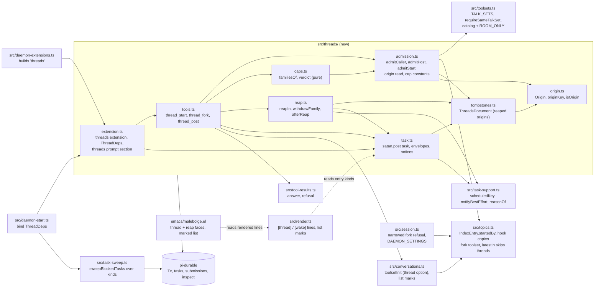
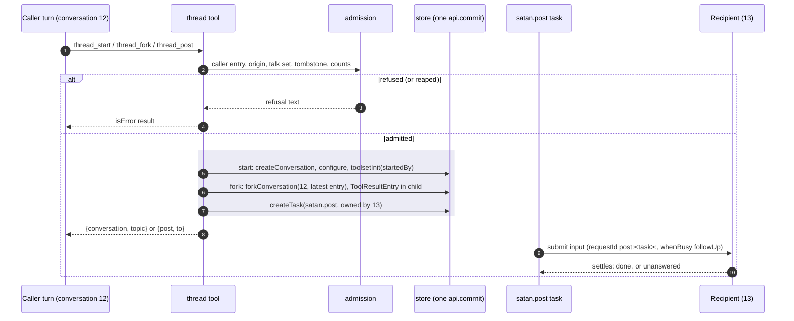
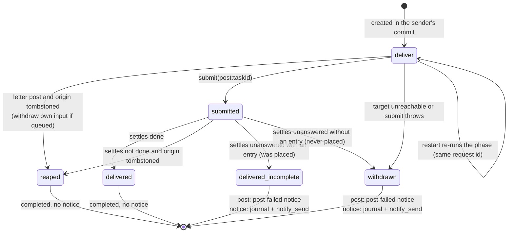

<!-- doctrine:section sec-1 -->
## Purpose and boundary

SATAN, the model running in the daemon's room profile, can today hold many
conversations under topics, each with a fixed toolset, but no conversation
can create, fork or message another. This slice adds **threads**: a
conversation can start a new conversation, fork itself, and post a message
into another conversation, and the recipient's reply is a post back.

Terms used throughout:

- **Thread**: a conversation a tool created, by start or by fork. A
  conversation an operator created is not a thread.
- **Post**: a message one conversation sends another. It is delivered as an
  input that starts (or queues behind) a turn in the recipient.
- **Talk set**: a closed set of toolsets whose conversations may start, fork
  and post into each other. The room's only talk set is `interactive`; mail
  is in none (RSK-002, the risk of mail text steering other conversations).
- **Origin**: the root input of a cascade of posts: the human input or wake
  that started the first turn. Every post carries its origin.
- **Family**: all active posts sharing one origin.
- **Reap**: stopping a family that grew too large: its queued posts are
  withdrawn, its origin is recorded as reaped (a **tombstone**), and the
  conversation it started from is told.
- **Notice**: a message the daemon itself delivers into a conversation:
  `<post-failed>` to a sender whose post failed, `<family-reaped>` to an
  originator whose family was reaped.

What changes, in one paragraph: a new `threads` extension, installed in the
room's interactive toolset only (DEC-038), gives the model three tools,
`thread_start`, `thread_fork` and `thread_post`. Each creates one durable
`satan.post` task that delivers a post into the recipient. Posts are bounded
against fan-out by counting active posts per origin and daemon-wide, and by
reaping. The conversation index learns which conversations are threads, so
attach-by-topic, topic-addressed wakes and the heartbeat keep landing in
operator-created conversations (DEC-037). The operator sees threads in the
journal, in `--list` and in the transcript (DEC-039). One daemon-wide harness
setting changes: a failed run now continues with the inputs queued behind it
(DEC-042).

Why it matters: it is the first step towards SATAN holding several lines of
work at once, each in its own context, that can hand work to each other
without the operator relaying messages.

The boundary:

- In: the room profile's interactive conversations; start, fork, post;
  origins, caps, reaping; IMP-017's fork branch (a fork's index entry carries
  its parent's toolset, and the startup refusal of forks narrows); operator
  visibility; the facts a thread needs in its prompt.
- Out: the host profile (DEC-038); mail in any talk set (RSK-002);
  task-owned conversations (IDE-002); talk across harnesses such as gptel
  runs (IDE-003); a second mode in the talk set; renaming toolset to mode
  (CHR-004); delayed or presence-gated threads; reconciling wake with posts
  (IMP-019); crash-safe tool receipts (IMP-020); a live view of threads
  (IDE-004); cost ceilings (satan IMP-053); per-conversation project context
  (RFC-002 D2). Threads differ from their parent in place (topic, cwd) and
  history, not in prompt or tools.
- Unchanged: `interactive.txt` and the rest of SATAN's corpus. Conduct
  between threads is SATAN's own prose to write (DEC-040).

<!-- doctrine:section sec-10 -->
## Components and boundaries

The diagram shows which module owns what and which way each dependency
points; the new code is the `src/threads/` box.



Responsibilities:

- `src/threads/tools.ts` parses arguments, gathers what the call needs about
  its caller, and composes one creating commit per call. It owns no policy.
- `src/threads/admission.ts` owns the admission reads and their refusals:
  `admitCaller` (the caller's entry, origin and tombstone), `admitPost` and
  `admitStart` (the target or topic, and the talk set), and the cap
  constants. Every one is a read, so the caller's one commit may follow.
- `src/threads/caps.ts` counts and decides: `familiesOf` and `verdict`, pure,
  taking plain data and tested without a harness.
- `src/threads/reap.ts` writes the reap: `reapIn` (tombstone and notice task,
  inside a given commit), `withdrawFamily`, and `afterReap` (withdraw,
  journal, notify).
- `src/threads/origin.ts` holds `Origin`, `originKey` and `isOrigin`, read by
  admission, tombstones and the task alike; a module of its own breaks the
  import cycle admission and tombstones would otherwise form.
- `src/threads/task.ts` owns the `satan.post` task: delivery, outcome, the
  envelopes the model reads, and the notices. It knows nothing of the tools.
- `src/threads/tombstones.ts` owns the one new persistent record. Nothing
  else names `ThreadsDocument`, as `topics.ts` is the index's only owner.
- `src/topics.ts` stays the index's only owner; threads reach the index
  through its functions, `readIndexDoc(tx)` for a read.
- `src/task-support.ts` (`SATAN_CALL_DEADLINE_MS`, `scheduledKey`,
  `notifyBestEffort`, `reasonOf`) and `src/tool-results.ts` (`answer`,
  `refusal`) are neutral helpers moved out of `src/wake/task.ts` and
  `src/wake/tools.ts`, so wake and threads share them without importing each
  other.

Coupling rules:

- `src/threads/` imports from `topics.ts`, `toolsets.ts`, `conversations.ts`
  (for `toolsetInit`), `satan-tools.ts` (the `Log` type and `notify_send`)
  and `satan-pool.ts` (`PoolKey`). It does not import from `src/wake/`: wake
  and posts deliberately do not share delivery code (DEC-035; reconciling
  them is IMP-019). Two small exceptions read wake's constants, not its
  behaviour: `WAKE_KIND` and the `EpisodeClass` type, which an origin
  records (read by `admission.ts` and `origin.ts`).
- Nothing outside `src/threads/` imports the threads module except
  `daemon-extensions.ts`, `daemon-start.ts` and `render.ts` (entry kind and
  data shape only).
- The start sweep of blocked tasks moves from `src/wake/sweep.ts` to a
  neutral `src/task-sweep.ts`: one function over a small per-kind table.
  Wake and threads each export their row; `daemon-start.ts` passes both. So
  neither `src/wake` nor `src/threads` imports the other, and the sweep
  imports neither.

```ts
// src/task-sweep.ts
export interface SweptKind {
  kind: string;                                  // "satan.wake", "satan.post"
  /** The journal's name for a task of this kind: `wake 7 blocked (...)`; keeps wake's lines byte-identical. */
  noun: string;
  requestPrefix: (taskId: TaskId) => string;     // whose queued inputs to withdraw
  /** The kind's own failure report for a blocked task (journal, best-effort notify). */
  report: (task: TaskInspection, reason: BlockedReason, ctx: Context) => Promise<void>;
}
/** At start, for each blocked task of a listed kind: withdraw its queued inputs, report, abort it. */
export function sweepBlockedTasks(
  harness: Pick<Harness, "inspect" | "abortSubmission" | "abortTask">,
  kinds: readonly SweptKind[],
  log: Log,
  ctx: Context,
): Promise<void>;
```
- Late binding: like the wake extension, the threads extension is built
  before the session exists, so its dependencies are read through a getter
  bound in two steps. `wakeBinding` (`src/wake/extension.ts:38-58`) is
  generalised into `lateBinding<Early, Late>(name)` in a new
  `src/late-binding.ts`, and both extensions use it rather than a second
  copy.

```ts
// src/threads/extension.ts
export interface ThreadDeps {
  profile: Profile;
  /** Model and cwd a started thread takes; cwd yields to its topic's. */
  defaults: ConversationDefaults;
  now(): number;
  log: Log;
  satan: Pick<SatanTools, "call">; // notify_send, best effort
  harness: Pick<Harness, "inspect" | "abortSubmission">;
}
export type EarlyThreadDeps = Omit<ThreadDeps, "harness">;
export type LateThreadDeps = Pick<ThreadDeps, "harness">;

export const threadsExtension = (deps: () => ThreadDeps, task = postTask(deps)): Extension =>
  defineExtension({
    name: "threads",
    tasks: [task],
    tools: [threadStart(deps, task), threadFork(deps, task), threadPost(deps, task)],
    sections: [section("threads", () => THREADS_SECTION, { tag: true })],
  });
```

<!-- doctrine:section sec-11 -->
## Talk sets and the catalog

A talk set is declared per profile, in a map beside `PROFILE_TOOLSETS`
(`src/toolsets.ts:61`), from toolset to talk-set name (DEC-032). A toolset
with no entry is in no talk set, so its conversations can neither use nor be
the target of a thread tool.

```ts
// src/toolsets.ts
export type TalkSet = "interactive";

/** Which talk set each toolset belongs to, profile by profile; absent means none (DEC-032). */
export const TALK_SETS: Readonly<Record<Profile, Partial<Record<DaemonToolset, TalkSet>>>> = {
  room: { interactive: "interactive" },
  host: {},
};

/**
 * The talk set `caller` and `target` share on `profile`, refusing when either
 * has none or they differ. Start, fork and post call it alike; `targetLabel`
 * names the target in the refusal (`conversation 13`, `topic inbox`).
 */
export function requireSameTalkSet(
  profile: Profile,
  caller: DaemonToolset,
  target: DaemonToolset,
  targetLabel: string,
): TalkSet;
```

Refusals, as the model reads them:

- caller in no set: `toolset mail has no talk set on profile room`
- target in no set, or another set: `conversation 13 (toolset mail) is outside
  this conversation's talk set (interactive)`; for a start, `topic inbox
  (toolset mail) is outside …`.

Invariants:

- `TALK_SETS[profile]` names only toolsets `PROFILE_TOOLSETS[profile].allowed`
  allows. A test enumerates both maps and asserts it, so the two cannot drift.
- Mail is in no talk set on any profile (RSK-002).
- Host has an empty map (DEC-038); enabling host later is one map line plus
  removing `threads` from `ROOM_ONLY`.

The catalog:

- `threads` joins the `interactive` list after `tasks` (so its section and
  tools follow the wake tools in prompt and tool order).
- `threads` joins `ROOM_ONLY`, so `toolsetList(…, "host")` filters it and a
  host never installs it, as it never installs `tasks` (W10).
- `DaemonParts` gains `threads: Extension`, and `builders` maps `"threads"` to
  it, mirroring `tasks` (`src/daemon-extensions.ts:16-40`).

Because the interactive list changes, the startup reconcile rewrites every
existing interactive conversation's list on the first restart after this
lands, logging one `toolset interactive list changed` line per conversation
(`src/session.ts:155-158`). That is the existing mechanism working as
designed, not a migration.

<!-- doctrine:section sec-12 -->
## Index entries, forks and a topic's latest

The conversation index (`src/topics.ts`, one session-scoped document) gets
one new field and three behaviour changes.

### The entry

```ts
export type IndexEntry = {
  topic: string;
  parent?: number;     // set by the hook for a fork (existing)
  startedBy?: number;  // new: the conversation whose thread_start created this one
  toolset: DaemonToolset;
};
```

Example entries, a fork and a started thread:

```json
{ "13": { "topic": "research", "parent": 12, "toolset": "interactive" },
  "14": { "topic": "ops", "startedBy": 12, "toolset": "interactive" } }
```

One predicate serves every reader that asks "did a tool create this?":

```ts
/** A conversation a thread tool created: a fork, or a thread_start's child (DEC-037). */
export const isThread = (entry: StoredEntry): boolean =>
  entry.parent !== undefined || entry.startedBy !== undefined;
```

### A fork carries its parent's toolset (DEC-033, IMP-017's fork branch)

The `conversationCreated` hook, `indexConversation`, already writes a fork's
`topic` and `parent`. It now also copies the parent entry's `toolset`, and
throws when the parent has no entry or no toolset (`conversation 13: fork of
12, which has no toolset`). A throw fails the forking
commit, so a fork without a toolset is never written. Every entry has a
toolset after the startup commit, and forks happen only through a tool after
startup, so the throw guards an invariant breach rather than a case.

The startup refusal `refuseUnsupported` (`src/session.ts:92-105`) narrows:
it refuses a fork **whose index entry has no toolset**, instead of every
fork, and still refuses every task-owned conversation. It runs in step 0 of
the reconcile, before the backfill gives any entry the profile's default, so
a fork is never silently given the default. It gains the index as an
argument (a document read, so pi-durable's read-after-write rule is not
touched).

Refusal text: `conversation 13: a fork without a toolset is not supported`.

The heartbeat needs no special case: a fork copies its parent's documents
and entries, not its tasks, so a fork of the heartbeat's conversation gets
the history but not the heartbeat.

### A thread_start records `startedBy`

`toolsetInit(profile, topic)` (`src/conversations.ts:122`) is the one
creating `init` every path uses. It gains an optional thread argument rather
than a parallel create path:

```ts
export interface StartedThread {
  /** The calling conversation, written as the entry's startedBy. */
  startedBy: ConversationId;
  /** Refuses a chosen toolset outside the caller's talk set, inside the creating commit. */
  require: (toolset: DaemonToolset) => void;
}
export function toolsetInit(profile: Profile, topic: string | undefined, thread?: StartedThread): ConversationInit;
```

`writeCreated` writes `startedBy` with `topic` and `toolset` when given. The
talk-set check runs on the toolset chosen inside the commit, so a topic's
toolset changed between the tool's read and its commit cannot slip through.

### A topic's latest skips threads (DEC-037, refining DEC-015)

```ts
/** The highest id in `topic` that no thread tool created: its latest (DEC-015, DEC-037). */
export function latestIn(index: IndexDoc, topic: string): number | undefined;
```

`latestIn` filters with `isThread` before taking the highest id. Its three
callers inherit the change: attach by topic (`src/conversations.ts:173`),
`wake_schedule {topic}` (`src/wake/tools.ts:57`), and the heartbeat's
re-creation through the same open. A topic holding only threads has no
latest: attach creates a new conversation there and `wake_schedule` answers
`topic x has no conversation`, as today for an empty topic. `idsIn` is
unchanged, so `--list --topic x` still shows every conversation, threads
included.

Invariants:

- Every ownerless conversation is indexed in its creating commit
  (DEC-012, RFC-002 D7); a thread is no exception.
- A fork's toolset equals its parent's at the fork (DEC-025 (1)).
- A conversation is a thread exactly when its entry has `parent` or
  `startedBy`; nothing else marks it.

<!-- doctrine:section sec-13 -->
## Origins, families and caps

Threads may loop (A posts to B, B replies to A, and so on): that is a
legitimate way to carry work forward, so there is no chain-depth cap. The
harm to bound is fan-out, where one activity multiplies posts. Every post
therefore carries its **origin**, and posts are counted per origin and
daemon-wide (DEC-036).

### The origin

```ts
// src/threads/origin.ts
export interface Origin {
  /** The conversation whose input opened the cascade. */
  conversation: ConversationId;
  /** That input's entry. pi-durable mints entry ids from one store-wide sequence, so a higher id is younger. */
  entry: number;
  kind: "human" | "wake";
  /** A wake origin's episode class; absent for a human origin. Recorded only (DEC-036 addendum). */
  episodeClass?: EpisodeClass;
}
/** How journals, tombstones and envelopes name an origin: "12/340". */
export const originKey = (origin: Origin): string => `${origin.conversation}/${origin.entry}`;
```

Example: `{"conversation": 12, "entry": 340, "kind": "wake", "episodeClass": "seclude"}`, key `12/340`.

The caller's origin is read from its **newest input entry**, scanning the
caller's entries newest first (`tx.scanEntries`, descending, paged) until an
input kind appears:

| newest input entry kind | origin of the caller's turn |
|---|---|
| `pi.user` (operator input) | new: `{conversation: caller, entry: its id, kind: "human"}` |
| `satan.wake` | new: `{…, kind: "wake", episodeClass: data.episodeClass}` |
| `satan.post` (a post or a notice) | inherited: `data.origin` |
| `pi.reset` (a reset with a handoff message) | new: `{conversation: caller, entry: its id, kind: "human"}` |

Boundary conditions:

- A thread's first input is its first post, so a child always inherits the
  origin of the call that created it.
- A `<family-reaped>` notice carries the reaped origin, so the turn it starts
  inherits it and cannot post or start threads (admission refuses).
- An operator input that lands mid-turn (steering) is the newest input from
  then on, so later calls in that turn open a new human origin. The operator
  driving a conversation re-roots its activity; this is intended.
- malebolge never resets a conversation today; the `pi.reset` row keeps the
  scan from inheriting an older origin across one if that changes.
- The scan is bounded by the length of the current turn (assistant and
  tool-result entries since the input). No input found is an invariant
  breach and refuses: `no input entry to take an origin from`.

### Counting

Active posts are counted from `harness.inspect` over live `satan.post` tasks
whose letter is `post` (notices are cap-exempt), grouped by `originKey`, as
`liveWakes` counts wakes (`src/wake/task.ts:101-120`). A post task is live
from its creating commit until it settles, which for a delivered post is when
the recipient's turn ends. A two-party loop therefore holds at most two
active posts at once: the one whose turn is running and the reply it sends.
K = 4 therefore admits two co-resident loops from one origin. This refines
DEC-036's rationale ('a loop holds one active post'), noted on DEC-036.

Two kinds of live task are not counted: a task whose origin is tombstoned
(its family was reaped), and a task whose inspection state is `blocked`
(parked by the restart limit, or without a registered definition), as the
heartbeat skips blocked wakes (`src/wake/heartbeat.ts:31-33`).

```ts
export const FAMILY_CAP = 4;   // K: active posts per origin
export const GLOBAL_CAP = 12;  // N: active posts daemon-wide

/** Active posts per origin key, from an inspection: blocked tasks and reaped origins left out. Pure. */
export function familiesOf(
  tasks: readonly TaskInspection[],
  reaped: (key: string) => boolean,
): ReadonlyMap<string, Family>;
interface Family { origin: Origin; active: number; taskIds: readonly TaskId[] }

/** What admitting one more post from `origin` does. Pure. */
export function verdict(
  families: ReadonlyMap<string, Family>, origin: Origin,
): { kind: "admit" }
 | { kind: "reap-own"; reason: string }                   // the caller's family crosses K, or is the largest over N
 | { kind: "reap-other"; family: Family; reason: string }; // another family is the largest over N
```

Rules, counting the post being admitted as active:

1. The caller's family would exceed K: reap the caller's family and refuse
   the call. Reason `5 active (cap 4)`.
2. Otherwise, the daemon would exceed N: reap the largest family, ties going
   to the youngest origin (highest origin entry id). Reason
   `13 active daemon-wide (cap 12); largest family`. If that family is the
   caller's, refuse the call; otherwise admit it.
3. Otherwise admit.

A reaped family's tasks still live while its placed turns drain; they are
not counted, so the daemon may briefly carry more than N live post tasks.
They cannot grow: admission refuses the origin. Leaving them out also means
a reaped family is never chosen as the largest again, so one reap writes
one tombstone and one notice.

Every refusal names its cap and the origin. Constants live in code.

### Sequential thread tools (DEC-041)

pi-durable runs a turn's tool calls in parallel by default, and `inspect`
serialises only its own read, so several thread calls in one message would
each see the same count. `thread_start`, `thread_fork` and `thread_post`
declare `executionMode: "sequential"`; one sequential call makes its whole
round sequential, so each call's count sees the previous call's committed
post task. The remaining overshoot is between turns running concurrently in
different conversations: bounded and accepted (DEC-036).

Consequence: any round that contains a thread call runs its other tool calls
sequentially too.

<!-- doctrine:section sec-2 -->
## The thread tools

Three tools, one per action (DEC-034, DEC-035). Each refuses with an
`isError` result naming why, and otherwise does all its writes in **one**
`api.commit`, so a crash before the commit leaves nothing and a crash after
it leaves a complete thread whose first post is a durable task.

| tool | arguments | returns | properties |
|---|---|---|---|
| `thread_start` | `intent: string`, `context?: string`, `topic?: string` | `{conversation, topic}` | sequential, replay `unsafe` |
| `thread_fork` | `intent: string`, `context?: string` | `{conversation, topic}` | sequential, replay `unsafe`, `callers: ["model"]` |
| `thread_post` | `to: number`, `intent: string`, `context?: string` | `{post, to}` | sequential, replay `unsafe` |

`intent` is why the thread or post exists, about one sentence, guidance only
(no hard cap); an identifier the recipient needs usually goes here.
`context` is optional material that helps the recipient understand or act,
possibly long. Both are free strings: prose, JSON, SQL or anything else. A
reply is a `thread_post` back to the post's `from`.

### Shared steps

Every call runs the same admission before its commit. Step 1 is one read
all three tools share (`admitCaller`), so a reaped origin is refused cheaply,
before anything else is resolved:

1. Read the caller: its index entry (toolset, topic), its origin
   (§ Origins) and its tombstone. Refuse a caller with no entry (`this
   conversation has no index entry`) and a tombstoned origin: `origin 12/340
   was reaped for fan-out; posts and thread starts from it are refused`.
2. Resolve the target (`admitPost`, `admitStart`) and check its talk set with
   `requireSameTalkSet`.
3. Count and decide (`verdict`). `reap-own`: commit the reap (§ Reaping,
   step 1) alone, and refuse with the reason: `origin 12/340 was reaped for
   fan-out: 5 active (cap 4); posts and thread starts from it are refused`.
   That commit also re-reads the tombstone first, and writes nothing if
   another conversation reaped the family meanwhile; the refusal then has no
   reason, as in step 1.
4. Otherwise commit the call's writes. For `reap-other`, the reap's writes
   (tombstone and notice task) go in this same commit, so a call whose
   creation fails reaps nobody. The commit first re-reads the caller's
   tombstone (`ThreadsDocument`, read before any table write) and refuses if
   it is now set: another conversation reaped the family between steps 1 and
   4. Step 1 stays as the cheap early refusal. Then run the reap's withdrawal
   step, if any, and journal (§ Visibility).

### The flows

The sequence shows the three calls from the caller's turn to the first turn
in the recipient; the box marks what one commit writes.



**thread_start** creates a conversation in `topic` (default: the caller's).
An unknown topic is refused (`unknown topic: x`); threads never create
topics. Its toolset is the topic's, else the profile default; its cwd the
topic's, else the daemon default (`ThreadDeps.defaults.cwd`). The commit:
`tx.createConversation({ownership: {kind: "ownerless"}})`, which returns the
new `ConversationRecord` whose `id` the later steps use (the hook writes the
entry), `configure(tx, id, {...defaults, cwd})`, then
`toolsetInit(profile, topic, {startedBy: caller, require})(tx, id)`, then the
first post's `createTask`. This is the same sequence `Harness#create` runs
(create, configure, init; `dist/harness/harness.js:258-276`), so the
attach path and the tool path share `toolsetInit` and differ only in who
holds the transaction. The cwd lookup is extracted from `creationCwd`
(`src/conversations.ts:156`) so both read it one way.

**thread_fork** forks the caller at its **latest entry**, keeps its topic and
toolset (DEC-033), and refuses unless its call is the only tool call in that
entry (DEC-031). One read serves both: the newest entry from
`tx.scanEntries({conversationId: caller, order: "descending"}, 1)` must be a
`pi.assistant` entry whose message holds exactly one `toolCall`, with id
`api.callId`; otherwise `thread_fork must be the only tool call in its
message`. `callers: ["model"]` keeps nested code-mode calls, which never
reach the transcript, from forking. The check assumes nothing appends to
the caller during the call. pi-durable appends a passive write (kind and data
only) at once even mid-run (`dist/harness/submissions.js:136-145`); malebolge
makes none today. If one is added, this check refuses loudly rather than
forking at the wrong point. The commit, reads first (pi-durable
refuses a table read after a table write):

```ts
const [latest] = (await tx.scanEntries({ conversationId: caller, order: "descending" }, 1)).items;
// … sole-call check on `latest` …
const { id: child } = await tx.forkConversation(caller, latest.id, { ownership: { kind: "ownerless" } });
await tx.appendEntry(ToolResultEntry, child, {
  model: [{
    role: "toolResult", toolCallId: api.callId, toolName: "thread_fork", isError: false,
    content: [{ type: "text", text: JSON.stringify({ fork_of: caller, purpose: "arrives as your first post" }) }],
    timestamp: api.now(),
  }],
  data: { diagnostics: [] },
});
const post = await createPostTask(tx, task, { letter: "post", to: child, from: caller, … });
```

The child's context then reads: the parent's history, the fork call, and a
result saying it is the fork of 12, in place of pi-durable's synthetic
`Tool result unavailable` error (EVD-002; pairing at
`dist/harness/context.js:217-243`). Its first post brings the purpose. The
parent's own call result is `{conversation: child, topic}`.

**thread_post** refuses unless `to` exists (`no conversation 13`), is
indexed (`conversation 13 is not in a topic (a task's conversation)`), is not
the caller (`a conversation cannot post to itself`) and shares the caller's
talk set. There is no presence gate. Its commit is the one `createTask`.

### Example results

```json
{"conversation": 14, "topic": "ops"}
{"post": 44, "to": 13}
```

### Interrupted calls (DEC-043)

The tools keep replay `unsafe`: pi-durable never reruns an interrupted call,
and reports it as interrupted. A crash after the creating commit and before
the result is recorded leaves a thread or post that exists while its caller
cannot tell; a model retry may duplicate it. This is an accepted residual:
a started child's first reply names it through `from`, `--list` marks
threads, and the caps bound duplicates. Call-keyed receipts with safe replay
are IMP-020.

<!-- doctrine:section sec-3 -->
## The satan.post task and its notices

A post is a durable task, `satan.post` v1, created in the sender's commit and
owned by the recipient conversation, in the background, as a wake is owned
by its target (`createWakeTask`, `src/wake/task.ts:136-145`). It delivers
through wake's submission idiom (a task-derived request id, `whenBusy:
"followUp"`, a typed entry) but **without a bound**: it waits until its input
is placed and settles, and is never withdrawn for waiting (DEC-035). The same
task kind delivers the two notices, so there is one delivery path.

### Input, entry and result

```ts
// src/threads/task.ts
export const POST_KIND = "satan.post"; // task kind and entry kind

export type PostInput =
  | { letter: "post"; to: ConversationId; from: ConversationId; topic: string; // the sender's topic
      origin: Origin; intent: string; context?: string }
  | { letter: "post-failed"; to: ConversationId; origin: Origin; post: number; recipient: ConversationId;
      outcome: "withdrawn" | "delivered-incomplete"; reason: string; intent: string }
  | { letter: "family-reaped"; to: ConversationId; origin: Origin; reason: string };

export type PostState = { phase: "deliver" };
export interface PostResult { outcome: "delivered" | "withdrawn" | "delivered-incomplete" | "reaped" }

/**
 * pi-durable dedupes it per conversation, so a re-run re-submits the same input.
 * Delimiter-terminated, as wake's `wake:<id>:`: the sweep and the reap match
 * request ids by prefix, and `post:44` would also match post 440's input.
 */
export const postRequestId = (taskId: number): string => `post:${String(taskId)}:`;
```

The entry the input is placed as has kind `satan.post`; its data is the
input plus `taskId`, for the transcript and for origin reads:

```json
{"taskId": 44, "letter": "post", "from": 12, "topic": "research",
 "origin": {"conversation": 12, "entry": 340, "kind": "human"},
 "intent": "Summarise the failing test runs", "context": "see /tmp/runs.txt"}
```

### Envelopes the model reads

Fields are interpolated raw, as wake's are; `<context>` appears only when
given, holding the string as given.

```xml
<post from="12" topic="research"><intent>Summarise the failing test runs</intent><context>see /tmp/runs.txt</context></post>

<post-failed post="44" to="13" outcome="delivered-incomplete" reason="unanswered (model_error)"><intent>Summarise the failing test runs</intent></post-failed>

<family-reaped origin="12/340" reason="5 active (cap 4)"/>
```

If the DEC-031 test (§ Verification) shows the child's written fork result
cannot stand, the fallback carries the fork's facts in its first post
instead, and pi-durable's synthetic result stays:
`<post from="12" topic="research" fork_of="12"><note>This conversation is a
fork of 12; its fork call's result reads unavailable by design.</note><intent>…</intent></post>`.

### One phase: deliver



The phase, in order:

1. For `letter: "post"` only, read the origin's tombstone (DEC-044). If
   reaped: look up this task's submission
   (`tx.submissionByRequest(to, postRequestId(id))`), withdraw it with
   `harness.abortSubmission` if still queued, and settle `reaped`.
2. Open the recipient (`runtime.conversation(to)`); absent is `withdrawn`,
   reason `target unreachable`.
3. Submit `{type: "input", whenBusy: "followUp", requestId, entry: {kind:
   "satan.post", data}, content: envelope}`; a throw is `withdrawn` with the
   error as reason.
4. Wait for the submission to settle, unbounded.
5. `done` is `delivered`. Otherwise re-check the tombstone (posts only): a
   reap that withdrew this input settles `reaped`. Otherwise the record
   decides: `unanswered` **with** an `entry` was placed, so
   `delivered-incomplete`; without one it was never placed, so `withdrawn`
   (DEC-045). The reason is `unanswered (<record.reason>)`.

A close (the harness shutting down) is not a failure: the phase rethrows and
re-runs on reopen, as wake's `reasonOf` does.

### Failure answers the sender (DEC-035, DEC-045)

A `post` ending `withdrawn` or `delivered-incomplete` creates a
`post-failed` notice task to its `from`, in the same commit that settles the
failed task, so the notice cannot be lost between them. `withdrawn` means the
recipient never read it; `delivered-incomplete` means it was placed but its
turn did not end done, so the recipient may have acted. Success sends
nothing.

Notices are **active** (they start or queue a turn in their recipient),
**cap-exempt** (never counted) and **terminal**: a notice that fails does not
produce another notice; it writes a journal line and a best-effort
`notify_send` to the operator over the recipient's scheduled satan
connection, as wake's `reportFailure` does. A notice's turn inherits its
origin, so a turn started by `<family-reaped>` cannot post. The tombstone
check in step 1 applies to `post` only: notices about a reaped family must
still arrive.

### Blocked post tasks

A post task parked as `blocked` (pi-durable's restart limit, or no registered
definition) is not counted (§ Origins). The existing start sweep of blocked
wakes becomes `sweepBlockedTasks` in a neutral module (§ Components), and
threads registers `satan.post` with it: for each blocked task it withdraws the
task's queued input by its request id, journals, and aborts the task. A
blocked `post` is reported to the operator by a journal line and a
best-effort `notify_send`, as a failed notice is: that is the `satan.post`
row's `report`. One sweep serves both kinds.

The report's journal line and notify title:

| task | journal line | notify title |
|---|---|---|
| a post | `post 44 failed: blocked (<reason>) origin 12/340` | `SATAN post blocked` |
| a notice | `notice 47 to 12 failed: blocked (<reason>) origin 12/340` | `SATAN thread notice failed` |

### Abort by the operator

The abort handler withdraws the task's input if still queued, and maps the
answer of `abortSubmission`, each with its reason: `aborted` is `withdrawn`
(`aborted`); `not_found`, or no submission yet, is `withdrawn` (`not
admitted`); `already_placed` is `delivered-incomplete` (`aborted while
placed`); `settled` reads the record as in step 5. A `post` then sends its
`post-failed` notice as above. The handler settles the task `aborted`.

### A failed run continues (DEC-042)

The daemon opens its harness with `afterFailedRun: "continue"`. A run that
fails (`model_error`, `no_model`) now starts the next run with the inputs
queued behind it, as an answer would, instead of leaving them queued until
another input arrives. Threads have neither the heartbeat nor an operator to
supply that input, so without this a post queued behind a failed run would
wait forever, hold a cap slot and send no notice. With it, every queued input
progresses: a post behind a failed run is placed in the next run; if that run
fails too, the post ends `delivered-incomplete` and its sender is told.

```ts
// src/session.ts
/** The daemon's harness-wide run policy (DEC-042; DEC-036's one-at-a-time follow-ups, pinned). */
export const DAEMON_SETTINGS: HarnessSettings = { afterFailedRun: "continue", followUpMode: "one-at-a-time" };
```

`followUpMode` is pi-durable's default already; stating it pins the premise
DEC-036's origin rule rests on (one queued follow-up placed per run) against
a change of default. The setting is daemon-wide: a wake or an operator input
queued behind a failed run is now answered in the next run as well. A
persistent model outage fails each queued run in turn, and each failed post
answers its sender once.

`continue` covers runs that fail (`model_error`, `no_model`). A run that
faults (malformed provider data, a storage rejection; `unanswered(faulted)`,
`dist/harness/live.js:133-155`) ends without placing the inputs queued behind
it; they wait for the conversation's next input. This is an accepted residual
(§ Residuals).

<!-- doctrine:section sec-4 -->
## Reaping and tombstones

A reap stops a family that crossed a cap (§ Origins). It withdraws the
family's queued posts, lets its running turns finish, refuses any further
post or thread start from its origin, and tells the originator once
(DEC-036). The tombstone is written first, in one commit with the notice's
delivery task (DEC-044); each post task enforces the tombstone wherever it
runs, so a crash mid-reap, or a post task that had not yet submitted, cannot
let the family continue, and pi-durable recovers the notice like any task.

### The tombstone record

```ts
// src/threads/tombstones.ts
export type ThreadsDoc = {
  /** Reaped origins by origin key. */
  reaped: Record<string, { at: number; reason: string }>;
};
/** Session scope, so a fork never copies it; nothing else names it. */
export const ThreadsDocument = defineDoc<ThreadsDoc>({
  kind: "malebolge.threads", version: 1, scope: "session", initial: () => ({ reaped: {} }),
  checkpointWhen: (_value, _ops, info) => info.deltasSinceBase >= 50, // as IndexDocument; pi-durable requires a policy
});

export const isReaped = (doc: ThreadsDoc, origin: Origin): boolean;
/** Write `origin`'s tombstone; false when it already existed, so the caller creates no second notice. */
export function tombstone(doc: ThreadsDoc, origin: Origin, reason: string, now: number): boolean;
```

Example:

```json
{"reaped": {"12/340": {"at": 1793260800000, "reason": "5 active (cap 4)"}}}
```

### The reap, in order

The lifecycle below shows a family from its first post to its end; the one
reap commit is what makes both the refusal and the notice survive a crash.

```mermaid
stateDiagram-v2
  [*] --> Active: first post from origin O
  Active --> Active: post admitted (family under K, daemon under N)
  Active --> Reaped: crossing call, one commit: tombstone(O) + family-reaped notice task
  Reaped --> Withdrawing: inspect; abortSubmission each queued family input
  Reaped --> Draining: crash before withdrawal; on recovery each family task withdraws its own input
  Withdrawing --> Draining: placed turns run to their end and cannot post
  Draining --> [*]: last family task settles
```



1. **The reap commit** writes the tombstone and, in the same commit, creates
   the `family-reaped` notice task to `origin.conversation`, only when
   `tombstone()` returns `true`. Commits serialise, so two conversations of
   one family reaping at once produce one tombstone and one notice. Both are durable
   together: from here admission refuses the origin, every family post task
   that runs, re-runs or settles sees the tombstone, and pi-durable runs (or,
   after a crash, recovers) the notice task like any other. There is no
   notice-owed flag and no startup scan. For a global-cap reap of another
   family, this commit is the admitted call's own commit (§ The thread
   tools, shared steps).
2. **Withdraw.** One `harness.inspect` gives the family's live post tasks
   and the queued submissions; each queued one whose request id is
   `post:<familyTaskId>:` is withdrawn with `harness.abortSubmission(id, ctx,
   to)`, one at a time. Each withdrawal removes exactly that input; it never
   uses `Conversation.abort`, which would withdraw every queued input of the
   recipient, including a co-resident loop's. The withdrawn tasks see their
   waits settle, find the tombstone and settle `reaped` with no
   `post-failed`. A crash during this step loses nothing: each remaining
   family task withdraws its own input when it re-runs (§ The satan.post
   task, step 1).
3. Journal one line, with the count withdrawn in step 2, and send a
   best-effort `notify_send` (§ Visibility).

The notice does not report how many posts were withdrawn: it is created
before the withdrawals, and its `reason` already states the family's active
count. DEC-036's example envelope carried a `withdrawn` count; it is dropped, as
recorded on DEC-044. The notice may therefore reach the originator before step 2 ends.
That is harmless: its turn inherits the reaped origin, so it cannot post, and
admission refuses the family from the reap commit on. When the originator is
the caller, as for a family-cap reap, the notice queues behind the caller's
own running turn.

What is never withdrawn: a post already placed. Its turn runs to its end; any
thread call in it is refused by admission, since the turn inherits the reaped
origin.

### Invariants

- After the reap commit, no new post or thread start from origin O is
  admitted. A post already in flight is stopped where it has not yet been
  placed: withdrawn by step 2, or by its own task when it runs. A post whose
  input is placed first (its tombstone check passed just before the reap
  commit, or the recipient's boundary placed it before step 2 reached it) is
  delivered; its turn inherits O and cannot post. So a reap stops a family
  within at most its in-flight posts (at most K, plus the accepted overshoot
  across concurrently running turns; § Residuals).
- A reap touches only inputs of family O, one submission at a time.
- The tombstone and the notice task exist together or not at all; the
  originator receives exactly one `<family-reaped>` per reaped origin, unless that
  notice itself fails, which journals and notifies.
- Tombstones are never pruned: one small entry per reaped origin.

### A reaped family and wakes (DEC-046, RSK-003)

`wake_schedule` is unchanged and records no origin, and every wake turn opens
a new origin. A reaped family's surviving turn, or its `<family-reaped>`
notice turn, can therefore schedule a wake whose turn starts a new family.
That family is capped and reaped like any other, and wake timing is clamped
and jittered, so the escape is bounded. It is an accepted risk, recorded as
RSK-003 with its deferred remedy (`wake_schedule` refusing a tombstoned
origin).

<!-- doctrine:section sec-5 -->
## Operator visibility

Threads are kept out of a topic's latest (§ Index), so the operator needs
other ways to find them, and a reap is an anomaly worth an interruption
(DEC-039). Four surfaces; no live feed (a list or live view is IDE-004).

### Journal

One line per event through `ThreadDeps.log`, each carrying the origin key, so
one activity can be grepped end to end:

```text
thread start 14 (ops) by 12 origin 12/340
thread fork 13 of 12 (research) origin 12/340
post 44 12->13 origin 12/340
post 44 failed delivered-incomplete: unanswered (model_error) origin 12/340
family 12/340 reaped: 5 active (cap 4); withdrew 3
notice 47 to 12 failed: target unreachable origin 12/340
```

### Notification

A best-effort `notify_send` on a reap, titled `SATAN threads reaped`, body
as the journal line. The other notifications are failures the operator must
see because no notice can carry them: a notice that fails, or a blocked task
(`SATAN thread notice failed`, `SATAN post blocked`; § Blocked post tasks).
A notify that fails changes nothing. Routine starts and posts never notify.

### --list marks threads

The `list` reply widens additively, as DEC-007 provides:

```ts
// src/protocol.ts
export type ThreadMark = { forkOf: number } | { startedBy: number };
export interface ConversationsMessage {
  type: "conversations";
  conversations: number[];
  truncated: boolean;
  /** Present when any listed id is a thread: its mark, by id. */
  marks?: Record<string, ThreadMark>;
}
```

`conversations.ts` fills `marks` from the index entries of the page's ids,
through one `markOf(entry): ThreadMark | undefined` in `topics.ts` beside
`isThread`. The renderer prints a marked id with a tab and its mark:

```text
14	started by 12
13	fork of 12
12
```

The Emacs picker's candidate parser (`malebolge--conversation-candidates`,
which today accepts only a bare id per line) accepts an id followed by a
tab and a mark, offers the whole line, and attaches to the id.

### Transcript lines

Today every user-role entry prints as the operator's turn (`You:` in Emacs,
`»` in the terminal), so posts and wakes would read as the operator's own
words. Entries are now rendered by kind, in one function shared by the
snapshot path and the live `message_end` path of `src/render.ts`:

| entry | rendered |
|---|---|
| `satan.post`, letter `post` | `[thread] post from 12 (research)`, then the intent and, if given, the context, one per line |
| `satan.post`, letter `post-failed` | `[thread] post 44 to 13 failed (delivered-incomplete): unanswered (model_error)`, header only |
| `satan.post`, letter `family-reaped` | `[thread] family 12/340 reaped: 5 active (cap 4)`, header only |
| `satan.wake` | `[wake] scheduled by 12 (seclude)`, then the intent |
| any other user-role entry | the operator's turn, as today |

`PresentationTable` gains one `input(kind, header, body)` rendering per
presentation; both presentations use the same `inputLine` (`[kind] header`,
then the body's lines). Unlike the operator's own typing, a post or wake is printed
live even where the terminal echoes typing, since no client typed it. Thread
tool calls stay `[tool]` lines.

The Emacs client gains `malebolge-thread-face` for `[thread]` lines and
`malebolge-reap-face` (inheriting `warning`) for `[thread] family … reaped`
lines: one font-lock rule each, in `malebolge--font-lock-keywords`, a
`defconst` (so a reload picks up changed rules). `[thread] post from …` and
`[wake] scheduled by …` are also speaker labels, so a post's or wake's body
lines take the label's face rather than the previous speaker's: the thread
face for a post, and `malebolge-wake-face` (inheriting the thread face;
IMP-021) for a wake, so a wake's intent is not coloured as SATAN's turn.
`malebolge--label-face` returns the first label that matches.

<!-- doctrine:section sec-6 -->
## Prompt surface

Text is split by coupling (DEC-030 (3), DEC-040): what the code emits and
enforces is stated in code and pinned by test; how SATAN regards its other
threads is SATAN's own corpus prose, written through its existing patch lane.
SL-006 changes no corpus file.

### Tool descriptions

Each states what the tool does, its arguments' meaning (§ The thread tools),
the refusals a model can cause, and, for start and fork, how a reply comes
back:

- `thread_start`: "Start a new conversation in a topic (default: this one's)
  and send it a first post. intent: why it exists, about a sentence;
  context: optional material. Refused for an unknown topic, outside this
  conversation's talk set, or over the post caps. It answers only by
  thread_post to you; ask for that if you want a reply. Returns its id and
  topic."
- `thread_fork`: "Fork this conversation as it stands, history included, and
  send the fork a first post. intent: why it exists, about a sentence;
  context: optional material. Must be the only tool call in its message.
  Refused over the post caps. It answers only by thread_post to you; ask for
  that if you want a reply. Returns the fork's id and topic."
- `thread_post`: "Post to another conversation by id; it starts or queues a
  turn there. Reply to a post by posting to its from. At most 4 active posts
  per activity and 12 in all; crossing a cap stops the activity. Returns the
  post id."

### The `threads` section

One section of the `threads` extension, tagged, its text a constant in
`src/threads/extension.ts` pinned by test. It states facts, and how a reply
comes back (DEC-040, as amended after VH-1):

```text
A <post> comes from another of your own conversations, a peer thread, not
from the operator. Its from is the conversation that sent it; reply with
thread_post to that id. A fork's thread_fork result names the conversation
it was forked from; its purpose arrives as its first post. A thread answers
you only by posting to you: what it says in its own turn stays in its own
transcript. When you want an answer, ask for a reply with thread_post, and
do not forbid it tools.

A <post-failed> says a post of yours failed, and why. outcome="withdrawn":
the recipient never read it. outcome="delivered-incomplete": the recipient
read it but its turn did not complete; it may have acted on it.

A <family-reaped> says an activity was stopped for fan-out: too many posts
at once from one starting input. Its posts not yet read are withdrawn, and
posts and thread starts from that activity are refused.
```

The reply sentences were added after VH-1, which showed a thread briefed "do
not use tools" with no way to answer. What it deliberately leaves out:
whether to trust a peer thread, how to
divide work, how to word replies. That is SATAN's conduct, written as
persona prose (DEC-040); SATAN may add a threads passage to
`interactive.txt` through its patch lane after this lands.

<!-- doctrine:section sec-7 -->
## Residuals and follow-ups

What this design knowingly leaves, each accepted by a decision or carried by
a backlog item:

| residual | why accepted | carried by |
|---|---|---|
| A thread call interrupted by a crash after its commit is ambiguous to its caller; a retry may duplicate the thread or post. | The window is one tool call during a daemon crash; caps bound duplicates; `from` and `--list` identify the child. | DEC-043; IMP-020 (call-keyed receipts, safe replay) |
| Counts can overshoot by a few posts when turns in different conversations post at the same moment. | Thread tools are sequential within a turn (DEC-041); across turns, consistency with the wake count beat exactness. | DEC-036, DEC-041 |
| A reaped family can resume later as a new family through a wake. | Each new family is capped and reaped; wake timing is clamped and jittered. | DEC-046; RSK-003 |
| A sender that keeps posting to a recipient whose runs fail loops like any loop: each post settles before the next, so caps never fill. | Loops are unbounded by design (DEC-036); a failing loop is one of them, and the sender's own turns stop when the model does. Cost ceilings are satan's. | DEC-036; satan IMP-053 |
| A legitimate fan-out wider than 4 is reaped. | K is a code constant and the refusal says why. | DEC-036 |
| A post queued behind a recipient turn that never ends, or behind a run that faults, waits and holds a slot. | Faults are rare (malformed provider data, storage rejection); any later input to the recipient places it; the operator can abort the post task, which sends `<post-failed>`. | DEC-035, DEC-042 |
| A family's post placed in the moment of its reap is delivered. | Its turn inherits the reaped origin and cannot post; at most K such posts. | DEC-044 |
| Wake and posts differ in delivery bound, failure reporting and extra-field name (`payload` vs `context`). | Reconciling them is outside threads. | IMP-019 |
| "Toolset" is not yet renamed "mode". | It reaches stored data and the wire. | CHR-004 |
| Threads cannot be spawned from gptel-hosted runs or other harnesses. | Talk across harnesses is decided later. | IDE-003 |
| No list or live view of threads and families. | Journal, `--list` marks and transcript lines suffice for now. | IDE-004 |
| A wake origin's episode class is recorded but nothing acts on it. | Cheap optionality for a later presence gate. | DEC-036 addendum |

<!-- doctrine:section sec-8 -->
## Verification

Tests run on the faux harness with the existing fixtures: `test/wake-fixture.ts`
(a store that outlives a close, a stopped clock, scripted satan-mcp) and
`test/harness-fixture.ts`. A `test/thread-fixture.ts` adds what threads need
on top: a room session with the threads extension bound, a scripted caller
turn that issues given tool calls, and readers for index entries, post tasks
and the tombstone document.

### Early tests for unverified premises

Three premises rest on reading pi-durable, not on a run. Each is a test at
the start of the phase that depends on it; a failure stops that phase and
returns to the operator with the fallback named here.

| premise | test (phase) | fallback |
|---|---|---|
| (a) A tool can append a `ToolResultEntry` for its own call id to a fork child, and the child's context shows it in place of the synthetic result (DEC-031). | `a fork's child sees the written fork result, not 'Tool result unavailable'` (fork phase) | The fork's first post carries `fork_of` and a note (§ The satan.post task); the synthetic result stays. |
| (b) Queued follow-ups are placed one per run, so one run has one origin (DEC-036). | `two posts queued behind a busy recipient are placed in two runs` (premises phase, PHASE-03, before the post task) | None in design: a failure undermines the origin rule and goes back to the operator. |
| (c) Withdrawing one queued post leaves a sibling input queued (DEC-036). | `withdrawing one queued post leaves the other queued input in place` (premises phase, PHASE-03, before the post task) | None in design: a failure means a reap could harm a co-resident loop, and goes back to the operator. |

### Existing tests affected

- `test/wake-wait.test.ts`: the `behindFailure` recipe and VT-1, VT-2 and
  VT-3 pin `afterFailedRun: "keep"` (the wake's input stays queued behind a
  failed run until the bound withdraws it). With DEC-042 a failed run
  continues with the queued input, so those cases are rewritten in the
  premises phase (PHASE-03), before the post task, to the new behaviour: the queued wake input is placed in the next
  run. Cases that need an input stuck in the queue get it from a held run
  rather than a failed one.
- `test/session.test.ts` `refuses a fork, names it, …`: becomes a refusal of
  a fork without a toolset, with the new text; a new case opens a store
  holding a fork with a toolset.
- The DEC-024 guard (every create path, across a restart, has exactly its
  toolset's tools) gains `thread_start` and `thread_fork`.
- `test/toolsets.test.ts`: the catalog and host-filter expectations gain
  `threads`.

### Key test titles

Talk sets and index:

- `TALK_SETS names only toolsets each profile allows`
- `requireSameTalkSet refuses mail, host and mixed sets, naming both toolsets`
- `the hook copies a fork's toolset from its parent, and fails the commit when the parent has none`
- `latestIn skips forks and started threads; a topic of threads only has no latest`
- `attach by topic and wake_schedule {topic} land on the operator-created conversation`

Tools:

- `thread_start creates a conversation in the named topic whose first turn is the post`
- `thread_start takes the topic's toolset and cwd, else the defaults, and records startedBy`
- `thread_start refuses an unknown topic and a topic outside the talk set`
- `thread_fork keeps the caller's topic and toolset and survives a restart`
- `thread_fork after compaction forks at the latest entry`
- `thread_fork with a sibling tool call is refused`
- `thread_post refuses a missing, unindexed or own target, and mail`
- `thread tools are not installed on host`

Posts and notices:

- `a post starts a turn in the recipient with from, topic and origin`
- `a post to a busy recipient is queued and placed when its turn ends`
- `a post queued behind a failed recipient run is placed with no further input; and across a restart` (DEC-042)
- `a post queued behind a faulted run stays queued until the recipient's next input` (pins the residual)
- `failure before placement reports withdrawn; abort after placement and a run failing after a tool succeeded report delivered-incomplete` (DEC-045)
- `a notice that cannot be delivered journals and notifies, and sends no further notice`

Origins, caps and reaping:

- `a human input and a wake open origins; a post inherits its post's origin`
- `one message issuing more thread calls than K admits K and the crossing call reaps the family` (DEC-041)
- `a family over 4 is reaped and its originator told, while a co-resident loop is untouched`
- `the global cap reaps the largest family, ties to the youngest origin`
- `a second call after a global-cap reap does not reap the same family again`
- `a call whose creating commit throws after a reap-other verdict leaves no tombstone and no notice`
- `two conversations of one family reaping at once create one tombstone and one notice`
- `a call admitted before its family is reaped by another conversation is refused in its commit and creates nothing`
- `two distinct reaps write two tombstones to the same stored document`
- `a blocked post task is not counted`
- `the start sweep withdraws a blocked post's queued input and aborts it`
- `a crash after the reap commit and before any withdrawal delivers no queued family post after restart` (DEC-044)
- `a post task created before the reap and not yet submitted withdraws itself` (DEC-044)
- `a post that passed its tombstone check before the reap commit is delivered, and its turn cannot post`
- `a post that passed its tombstone check before the reap commit and restarted before its submit re-checks on re-run and settles reaped`
- `a crash right after the reap commit delivers the family-reaped notice once after restart, with no startup scan` (DEC-044)
- `a turn started by family-reaped cannot post or start threads`

Visibility and prompt:

- `posts, notices and wakes render as [thread] and [wake] lines in both presentations, live and in a snapshot`
- `--list marks forks and started threads; the Emacs picker attaches to a marked id`
- `the threads section text is pinned`

### Verified by the operator (VH)

In the room, SATAN starts a thread in another topic, posts to it and
receives a reply; the operator attaches to both and sees the post lines
coloured.

<!-- doctrine:section sec-9 -->
## Code impact

| path | change |
|---|---|
| `src/threads/extension.ts` (new) | `ThreadDeps`, the `threads` extension, `THREADS_SECTION`. |
| `src/threads/tools.ts` (new) | `thread_start`, `thread_fork`, `thread_post`: sequential, replay `unsafe`; `thread_fork` `callers: ["model"]`. |
| `src/threads/admission.ts` (new) | `admitCaller`, `admitPost`, `admitStart`: the admission reads and refusals; the caller's origin read; `FAMILY_CAP`, `GLOBAL_CAP`. |
| `src/threads/origin.ts` (new) | `Origin`, `originKey`, `isOrigin`. |
| `src/threads/caps.ts` (new) | `familiesOf`, `verdict`. |
| `src/threads/reap.ts` (new) | `reapIn`, `withdrawFamily`, `afterReap`: the reap's writes, withdrawal and report. |
| `src/task-support.ts` (new) | `SATAN_CALL_DEADLINE_MS`, `scheduledKey`, `notifyBestEffort`, `reasonOf`, moved from `src/wake/task.ts`. |
| `src/tool-results.ts` (new) | `answer`, `refusal`, moved from `src/wake/tools.ts`. |
| `src/wake/task.ts`, `src/wake/tools.ts` | The helpers above move out; behaviour unchanged. |
| `src/threads/task.ts` (new) | `satan.post` v1: `POST_KIND`, `PostInput`, `PostState`, `PostResult`, `postRequestId`, `postTask(deps)` (the definition, as `wakeTask`), `createPostTask(tx, task, input)` (owned by `input.to`, background, as `createWakeTask`); delivery, outcomes, envelopes, notices, abort handler; the `satan.post` `SweptKind` row. |
| `src/threads/tombstones.ts` (new) | `ThreadsDocument`, `isReaped`, `tombstone`. |
| `src/late-binding.ts` (new) | `lateBinding<Early, Late>`, generalised from `wakeBinding`. |
| `src/wake/extension.ts` | `wakeBinding` becomes a use of `lateBinding`. |
| `src/task-sweep.ts` (new) | `SweptKind`, `sweepBlockedTasks`: the start sweep, moved out of `src/wake/sweep.ts`, over a per-kind table. |
| `src/wake/sweep.ts` | Shrinks to wake's `SweptKind` row: its wake-specific part (no report for the heartbeat or an abort already requested; otherwise `reportFailure`). |
| `src/toolsets.ts` | `TalkSet`, `TALK_SETS`, `requireSameTalkSet`; `threads` in the interactive list and in `ROOM_ONLY`. |
| `src/topics.ts` | `IndexEntry.startedBy`; `isThread`, `markOf`, `readIndexDoc`; the hook copies a fork's toolset and throws without one; `writeCreated` writes `startedBy`; `latestIn` skips threads. |
| `src/conversations.ts` | `toolsetInit` takes the optional `StartedThread`; the cwd lookup extracted for reuse; list pages carry marks. |
| `src/session.ts` | `refuseUnsupported` narrows to a fork without a toolset; `DAEMON_SETTINGS` passed to `Harness.open`. |
| `src/daemon-extensions.ts` | `DaemonParts.threads`; the `threads` builder. |
| `src/daemon-start.ts` | Build and bind `ThreadDeps` (early and late, beside the wakes'); `startWakes` becomes `startRoomTasks`, which passes the wake and post rows to `sweepBlockedTasks` at room start. |
| `src/protocol.ts` | `ThreadMark`; optional `marks` on `ConversationsMessage`. |
| `src/daemon.ts` | Pass a list page's marks into the reply. |
| `src/render.ts` | Input entries rendered by kind (`[thread]`, `[wake]`) in snapshot and live paths; marked list lines. |
| `emacs/malebolge.el` | `malebolge-thread-face`, `malebolge-reap-face` and their rules; the post and wake headers as speaker labels; the picker parses marked lines. |
| `test/thread-fixture.ts` (new), `test/threads-*.test.ts` (new) | § Verification. |
| `test/late-binding.test.ts`, `test/queue-premises.test.ts`, `test/task-sweep.test.ts` (new) | `lateBinding`; premises (b) and (c); the shared sweep. |
| `test/wake-wait.test.ts`, `test/session.test.ts`, `test/toolsets.test.ts`, `test/conversations.test.ts`, `test/topics.test.ts`, `test/render.test.ts`, `test/malebolge-ert.el` | Updated as § Verification lists. |
| `test/wake-*.test.ts`, `test/daemon*.test.ts`, `test/conversation-context.test.ts`, `test/structure.test.ts`, `test/harness-fixture.ts` | Follow the moved helpers, `startRoomTasks`, `DAEMON_SETTINGS` and the threads catalog entry. |

Unchanged: wake's delivery and scheduling (only its rendering changes, and
its helpers move out), `src/conversation-context.ts`, SATAN's corpus, the
runner and its harness.

