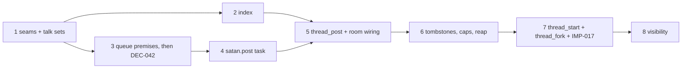

# Implementation Plan SL-006: Threads: start, fork and post among interactive conversations

Prose companion to `plan.toml`. Narrative only — no queried data lives here
(the storage rule); the phase list, criteria, verification, and links are
authored in the TOML. Use this for the plan's rationale and sequencing.
<!-- Reference forms: `lib:reference/glossary.md` § reference forms. -->

## Overview

Eight phases build threads bottom-up: seams, the index, the queue premises
and then the daemon-wide run policy, the durable post, the first tool wired
into the room, the caps and reap, start and fork, and operator visibility.
Each phase ends with the full suite green; no phase leaves a fixture or
literal broken for a later phase to fix.

## Sequencing & Rationale

- **PHASE-01 first, behaviour-neutral.** lateBinding, the neutral sweep and
  TALK_SETS have no observable effect, so a failure here is a refactor
  failure. The sweep's call sites change, but its journal assertions do not:
  wake's tests are the oracle. The structure test takes the design's
  coupling rules now, while they cost one allowlist and nothing violates them.
- **PHASE-02, the index, before any tool.** `latestIn` and the thread
  predicate are needed by start and by `--list`, and touch attach by topic.
  No store holds a thread yet, so production behaviour is unchanged. IMP-017's
  fork branch is absent: DEC-033 lands it with `thread_fork`.
- **PHASE-03: premises, then DEC-042.** The design places the
  `afterFailedRun: continue` change after the tests that prove premises (b)
  and (c). They are the phase's first tests and drive raw submissions, so
  they precede any post code; a failure stops the slice before anything
  daemon-wide lands. DEC-042 then sits alone with the wake rewrites it
  forces (both `behindFailure` recipes), so a regression is attributable to
  it. The premises sit in their own phase rather than at the head of the
  post-task phase, which would otherwise be oversized; the gate is the same.
- **PHASE-04 tests delivery without a tool.** The post task is driven through
  `createPostTask` from the fixture. The tombstone check is left to PHASE-06,
  which owns everything about a reap; until then no tombstone can exist.
  `Origin` lands here as pure data, because the post's input carries it.
- **PHASE-05 ships the first tool and the room wiring together.** A catalog
  entry forces the builder, the `DaemonParts` field, the daemon binding and
  the baseline delta; splitting them would leave the daemon unable to start.
  The frozen baseline is not regenerated: the comparison leaves out the
  threads extension and a new case pins exactly what it adds.
- **PHASE-06 caps right after the first tool.** Caps are needed by every
  tool, and `thread_post` alone exercises them, so start and fork then plug
  into a complete admission rather than being reworked. This also keeps the
  window in which main carries uncapped thread tools to one phase.
- **PHASE-07 start and fork together** (DEC-033). The DEC-031 premise is
  probed first; unlike the queue premises it has a design fallback, so its
  outcome selects a path rather than stopping the phase, and one behavioural
  test (the child learns its parent and purpose) holds on either path.
- **PHASE-08 visibility last.** It reads the settled `satan.post` entry shape;
  `markOf` lands here with `ThreadMark`, its return type and first consumer.
  ERT runs on the host (`just ert`), outside `just check` and the pi sandbox.
  The one VH criterion needs every piece.

## Notes

- Journal lines are emitted and pinned by the phase that creates each event
  (failed posts and notices in 4, posts in 5, reaps in 6, start and fork in
  7); PHASE-08 is operator surfaces only.
- Test titles mirror design § Verification where the design names one; every
  VT keyword was checked absent from `src/`, `test/` and `emacs/` when the
  plan was revised, so the VT gate cannot pass on existing text.
- Do not run the daemon from a commit between PHASE-05 and PHASE-06: the
  room then offers `thread_post` without caps.
- Residuals the design accepted (DEC-043/IMP-020, RSK-003, the race and
  faulted-run rows of design § Residuals and follow-ups) are not re-opened;
  PHASE-04 pins the faulted-run residual rather than fixing it.
