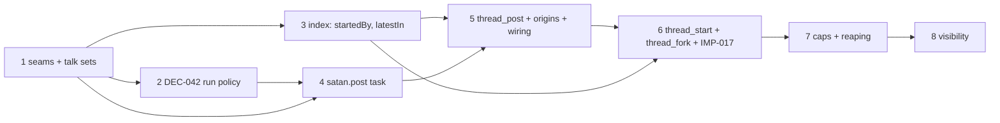

# Implementation Plan SL-006: Threads: start, fork and post among interactive conversations

Prose companion to `plan.toml`. Narrative only — no queried data lives here
(the storage rule); the phase list, criteria, verification, and links are
authored in the TOML. Use this for the plan's rationale and sequencing.
<!-- Reference forms: `lib:reference/glossary.md` § reference forms. -->

## Overview

Eight phases build threads bottom-up: seams and policy, the daemon-wide run
policy, the index, the durable post, the first tool, start and fork, the
caps, and operator visibility. Each phase ends green and leaves the daemon
working; none leaves a tool half-wired.

## Sequencing & Rationale

- **PHASE-01 first, behaviour-neutral.** lateBinding, the neutral sweep and
  TALK_SETS are prerequisites with no observable change, so a failure here is
  a refactor failure. The sweep move is a pure move: wake's tests are the
  oracle.
- **PHASE-02 alone (DEC-042).** `afterFailedRun: continue` changes wake and
  operator-input behaviour for the whole daemon and forces a rewrite of
  test/wake-wait.test.ts. The design places that rewrite in the post phase;
  the plan lands it earlier and separately so a regression is attributable to
  one cause, and so PHASE-04's failed-run VT runs against the final policy.
  This moves a test-edit placement only; the mechanism is the design's.
- **PHASE-03 before any tool.** The index predicate and `latestIn` are
  needed by start and by `--list`, and are the one place existing behaviour
  (attach by topic) is touched. IMP-017's fork branch is deliberately absent:
  DEC-033 lands it with `thread_fork`, since a store holding a fork with a
  toolset is only reachable through the tool.
- **PHASE-04 tests delivery without a tool.** The post task is driven through
  `createPostTask` from the fixture. Its first two tests are the unverified
  queue premises (one follow-up placed per run; sibling withdrawal). They
  gate the origin rule and the reap, so they come before the code that
  depends on them. There is no design fallback: a failure stops the phase.
- **PHASE-05 ships the first tool with caps stubbed.** `thread_post` is the
  smallest tool that exercises admission, origin read, wiring, the catalog
  change (and its restart reconcile) and the section. `verdict` admits
  everything until PHASE-07; because the stub is replaced by a function with
  the final signature, no tool changes then.
- **PHASE-06 start and fork together.** Both create a conversation in one
  commit and both need the new index behaviour; fork's IMP-017 branch must
  ship with it. The DEC-031 premise test is its first test; unlike the queue
  premises it has a design fallback, to be applied and recorded rather than
  stopped on.
- **PHASE-07 caps last among behaviour.** It is the riskiest logic (reap
  under concurrency and crash), and benefits from all three tools existing
  and being sequential. Pure parts (`familiesOf`, `verdict`) first, harness
  tests after.
- **PHASE-08 visibility last.** It reads the settled `satan.post` entry shape;
  rendering earlier would chase a moving shape. The only VH criterion sits
  here because it needs every piece.

## Notes

- Journal lines are emitted by the phase that creates each event (posts in 5,
  start and fork in 6, reap in 7); PHASE-08 is operator surfaces only.
- Test titles in `plan.toml` mirror design § Verification so the VT gate can
  match them. Several keywords are phrases the repo's tests may already
  contain; the first red test of each phase should be checked for a title
  that is genuinely new.
- Residuals the design accepted (DEC-043/IMP-020, RSK-003, the race and
  faulted-run rows of design § Residuals) are not re-opened; VT-5 of PHASE-04
  pins the faulted-run residual rather than fixing it.
