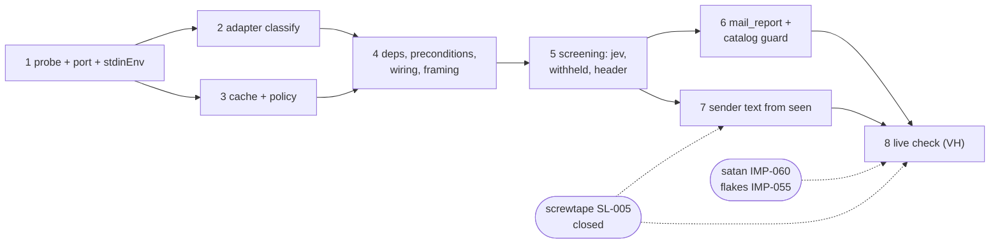

# Implementation Plan SL-007: Classified mail: mail tools carry screwtape classify answers

Prose companion to `plan.toml`. Narrative only — no queried data lives here
(the storage rule); the phase list, criteria, verification, and links are
authored in the TOML. Use this for the plan's rationale and sequencing.
<!-- Reference forms: `lib:reference/glossary.md` § reference forms. -->

## Overview

Eight phases build classified mail bottom-up: a transport probe and the
port, the adapter, two pure modules, wiring and framing, screening in the
tools, the self-report tool, the switch of sender text to `seen`, and the
operator's live check. Each phase ends with `just check` green; none leaves
a fixture or caller broken for a later phase.

## Sequencing & Rationale

- **PHASE-01 probes first.** ASM-002 (the gateway client socket serves Jev's
  path as the relay does) underlies DEC-059's transport. Checking it before
  any code costs one socat bridge, and a failure goes back to the operator
  and satan IMP-060 before anything depends on it. The rest of the phase is
  behaviour-neutral: types, schema, fixture, a fake member, a new module.
- **The schema lands early, the projection late.** `SeenSchema` is shape
  only and is transcribed from screwtape's committed README, so the adapter
  can be built and tested against it in PHASE-01/02. Only PHASE-07 depends
  on `seen`'s content, so it runs last among code phases, while screwtape
  SL-005 (which carries screwtape IMP-006) finishes its audit. PHASE-07/EN-2
  re-reads the contract in case the audit moved it.
- **PHASE-03 is independent of PHASE-02.** Both pure modules need only the
  PHASE-01 types; they can run in either order or in parallel.
- **PHASE-04 gathers every injection before any tool uses one.**
  `MailDeps` grows once, and `fakeMailDeps` becomes the one builder, so the
  five test files that build `MailDeps` move once. Framing sits here too,
  because the error prefix and the refusal leave through the same path in
  `mailTool`. The `UNTRUSTED:` line is the only change to the shared
  `src/untrusted-block.ts`; SL-008 is closed, so no other session's commits
  need ordering around it.
- **PHASE-05 before PHASE-06.** `mail_report`'s journal line renders the
  cached `jev`, and its effect is a withheld item, so it needs `jevField`
  and `projectWithheld`.
- **Interim state between PHASE-05 and PHASE-07.** Shown items carry `jev`
  but still take sender text from the read, so DEC-048's invariant holds
  only after PHASE-07. Nothing deploys between them: the room runs this
  slice's build only at PHASE-08.
- **PHASE-08 waits on three other repos.** satan IMP-060 (bridge, bind,
  variable), flakes IMP-055 (unit credential, `LimitCORE=0`), and a
  deployed screwtape with `seen`.

## Verification approach

Per the operator's verification choice (design-run inq-9, carried by
design § Verification): VT over fixtures and fakes, one VA (the probe),
one VH (the live check). Framing wording is unpinned (DEC-061): one
assertion ties `MAIL_SECTION` to the rendered block tag, and there are no
other framing-phrase tests. No test pins a bound's value. VT keywords name
identifiers and test titles the phase writes, so `verify-vt` has signal.

## Notes

- The research baseline reports drift only in this slice's own scope and
  design documents (the DEC-094 rebase); no research thread's code evidence
  moved, so research.md was not refreshed.
- Design-review routed findings: RV-020 carries none (no finding has a
  `demonstrate`, `probe` or `control` route), so no criterion transcribes one.
- Uncommitted: operator has not asked for commits (slice notes § Harvest).
