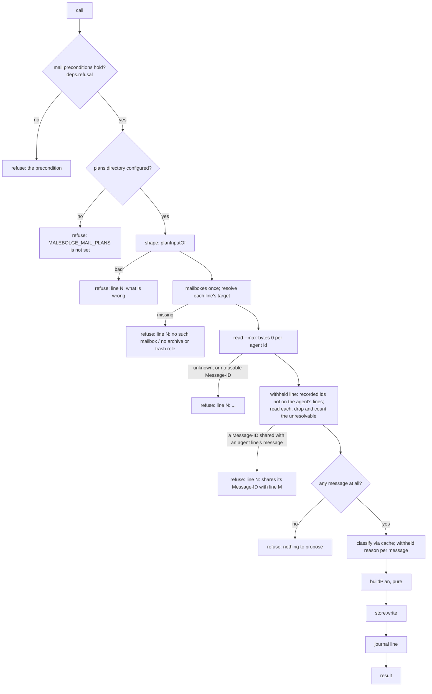
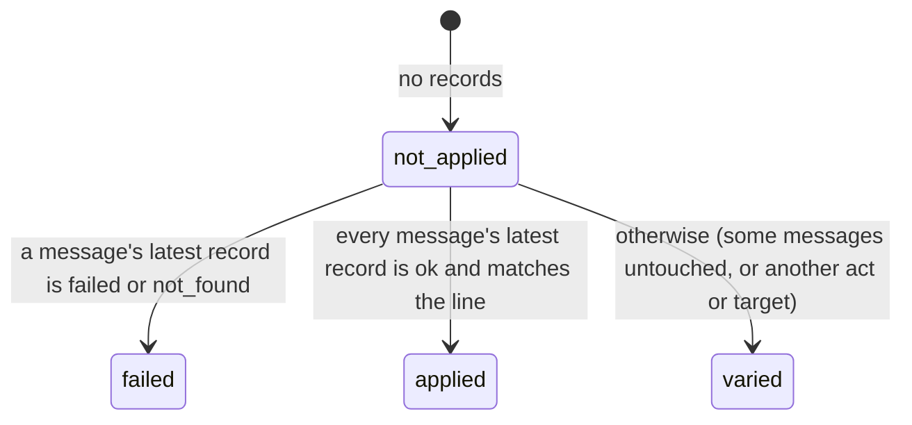

<!-- doctrine:section sec-1 -->
## 1. Overview

Today the mail agent reads mail and replies in prose; it changes nothing
(DEC-029). This slice lets it **propose** changes as data, which the operator
reviews and carries out in Gnus with their own IMAP credentials. The agent
never executes anything and never sees what happened to its plan.

Three parts, three trust levels:

```
 mail conversation (Q1: may be infected)
   │ mail_propose{lines:[{ids, action, mailbox?, rationale}]}
   ▼
 malebolge daemon (trusted TypeScript)                       src/mail/plans.ts
   validate → resolve each id through screwtape → add withheld mail
   → write <plans dir>/<plan id>.json  (create-exclusive, never rewritten)
   │
   │ the directory is the only channel: no attach-protocol change
   ▼
 Emacs (trusted elisp, operator's credentials)            emacs/malebolge-mail.el
   plan document: org buffer, no file — one heading per line (batch)
   RET on a line → ephemeral nnselect Gnus summary, proposed actions staged
   operator commits (q, B m, malebolge move) or discards (Q)
   Gnus hooks → append <plans dir>/acts.jsonl
```

The plans directory sits outside every SATAN read root (RSK-002 gap 3), so a
plan, a Q2 derivative of mail, reaches only the operator. Every identity and
every description of a message in a plan comes from the mail store (screwtape,
then Gnus), never from the agent: the agent contributes the grouping, the
action and a one-line rationale, and nothing else.

| decision | choice |
|---|---|
| DEC-108 | `mail_propose` writes one whole plan; a line is one action over a set of messages; closed action set; caps; replay unsafe |
| DEC-109 | malebolge derives Message-ID, IMAP paths, pre-state and header snapshot from screwtape; withheld and reported mail must appear |
| DEC-117 | malebolge tracks withheld mail shown to each conversation and adds it to every plan on its own line (refines DEC-109) |
| DEC-110 | plans in `MALEBOLGE_MAIL_PLANS`, outside SATAN read roots, create-exclusive JSON; the room jail binds it read-write |
| DEC-111 | plan files are immutable; status derives from the act log; dismiss moves the file to `dismissed/` |
| DEC-112 | a plan line opens as an ephemeral nnselect group from a scoped gnus-search on its Message-IDs |
| DEC-113 | opening a line stages its actions; only the operator's Gnus commit reaches the server |
| DEC-114 | append-only `acts.jsonl`; every server-reaching act from a plan's summary is logged; variations = plan − log |
| DEC-115 | the elisp is `emacs/malebolge-mail.el`, feature `malebolge-mail` |
| DEC-116 | the plan renders into an org buffer visiting no file; untrusted text sanitised; plan document for batches, Gnus for messages |

Unchanged: the six existing mail tools' behaviour and bounds, classification
and the withhold policy (SL-007), the attach protocol (DEC-002), and the mail
toolset's composition apart from the new tool (DEC-029). Evidence:
`research/research.md`.

**Phase-tuned, not open.** The operator tunes the plan document and Gnus
summary with an agent in a late VH phase, after the first working version:
columns, keys, folding versus re-rendering to show more of a line, and
whether opening and staging are one key or two. §6 and §7 give a concrete
first version of each and mark these points.

<!-- doctrine:section sec-10 -->
## 10. Code impact

| path | change |
|---|---|
| `src/mail/plans.ts` | new: `PLAN_ACTIONS`, `LineAction`, caps, `Plan`/`PlanLine`/`PlanMessage`, `planInputOf`, `messageIdUsable`, `imapPathOf`, `targetOf`, `snapshotOf`, `foreignLine`, `buildPlan`, `planIdOf`; pure (§2, §3, §5) |
| `src/mail/plan-store.ts` | new: `PlanStore`, `planStore(dir)`; the daemon's only file writer (§4) |
| `src/mail/tools.ts` | `mail_propose` registration and `proposeText`; `MailToolSpec.replay`; `MailDeps` gains `plans` and `shownWithheld`; `screened` and `mail_report` call `noteWithheld`; the four read `*Text` functions take `api` (§2) |
| `src/mail/extension.ts` | `MAIL_SECTION` guidance for `mail_propose`; header comment's tool count (§2) |
| `src/config.ts` | `mailPlansOf`; `Config.mailPlans` (§4) |
| `src/daemon-start.ts` | `mailPart` passes `plans` (`planStore` or undefined) and `shownWithheld: new Map()` (§4) |
| `emacs/malebolge-mail.el` | new feature `malebolge-mail`: settings, validating reader, both text rules, renderer, plan mode and commands, query building, open/stage, move command, hooks and advice, act records, line status (§5–§8) |
| `test/mail/plans.test.ts` | new: pure plan functions |
| `test/mail/plan-store.test.ts` | new: store against a temp directory |
| `test/mail/tools.test.ts`, `test/mail/mail-fixtures.ts` | `mail_propose` through `fakeMailDeps`; in-memory `PlanStore` fake; withheld tracking |
| `test/config.test.ts` | `mailPlansOf` cases |
| `test/toolsets.test.ts` | VT-3: exactly seven mail tools, in order (DEC-049's non-egress pin); its title says seven |
| `test/fixtures/text-rules.json` | new: the shared cases for `foreignLine` and `messageIdUsable` and their elisp twins, read by both suites (§5) |
| `test/malebolge-mail-ert.el` | new ERT suite; fixture plans and act logs under `test/fixtures/mail-plans/` |
| `justfile` | `ert` loads the new suite and byte-compiles `emacs/malebolge-mail.el` with warnings as errors |
| `README.md`, `docs/internals.md` | seven mail tools; the plans directory; the jail bind; loading `malebolge-mail` |
| `~/dev/satan/flake.nix`, `~/flakes/features/satan/malebolge.nix` | jail bind and variable (§9) |

Unchanged: `src/toolsets.ts` (the mail catalog is the extension's tool list),
`emacs/malebolge.el`, the attach protocol, `src/mail/render.ts`, which
`mail_propose` does not use because its result is one plain line.

<!-- doctrine:section sec-11 -->
## 11. Verification

```
PHASE-01 live probe (VH) ─► TS tool + store (vitest) ─► elisp (ERT) ─► jail + live run (VH) ─► UI tuning (VH)
```

### Live probe first (inq-10)

Before the elisp is built, a short probe in the operator's running Gnus,
recorded as evidence. It settles the assumptions the design carries:

| question | design point that depends on it |
|---|---|
| does a multi-way `message-id:… or …` search, scoped to several groups, return exactly the expected (group, uid) triples on Fastmail? | §7 step 2 (query form) |
| does `B m` from an nnselect summary `UID MOVE` a message to a folder and back? | §7 move |
| is a child of the inbox `INBOX/<name>` over IMAP? | §3 IMAP path rule |
| is `malebolge-mail--pushing` bound when `gnus-after-set-mark-hook` fires on `q`? | §8 mark capture |
| does `gnus-activate-group` return nil for a group that does not exist on the server? | §7 move step 2 |

A failed answer changes the function named in the right-hand column, not the
design's shape. A different shape goes back through `/consult`.

### Tests (vitest, `just check`)

- `mail_propose` refuses each input class with nothing stored: not an array,
  more than 20 lines, an empty `ids`, an unknown action, `mailbox` missing for
  `move` or present otherwise, rationale empty / over 280 bytes / with a
  newline / with a bidi override, more than 100 messages, an id on two lines,
  an unknown mailbox, no `archive` or `trash` role, an id screwtape does not
  know, a message with zero, two, or an unusable Message-ID, two messages
  sharing one Message-ID across an agent line and the withheld line, and
  nothing to propose. No refusal repeats the agent's value.
- `mail_propose` refuses with the configuration reason when `plans` is
  undefined, and with the mail precondition when `deps.refusal` is set.
- A valid call writes one plan whose identities, header snapshot and
  pre-state come from the source fake, not the arguments. Its result and
  journal line hold no agent text.
- Withheld mail: a withheld item shown by `mail_list` in conversation A
  appears on the `none` line of A's next plan and not of B's. An id already on
  an agent line is not repeated. An unresolvable id is counted in
  `withheld_missing`. Past 100 ids `withheld_overflow` counts.
- `imapPathOf`: the four rows of §3's table, a missing parent, a cycle.
- `foreignLine` and `messageIdUsable`: every case in
  `test/fixtures/text-rules.json` (§5).
- `planStore`: writes `<id>.json` whole, mode 0600, and leaves no temporary
  behind. A second write of the same id fails and leaves the first unchanged.
- `mailPlansOf`: unset and empty give undefined; relative throws; under each
  SATAN root throws; a host-like profile without mail ignores it.
- VT-3: exactly seven mail tools, in order (DEC-049's pin); the mail catalog
  guard still excludes coding, SATAN and write tools.
- `mail_propose` is `replay: "unsafe"`; the other six remain `"safe"`.

### Tests (ERT, `just ert`)

- The validating reader refuses a wrong format or version, an unknown action,
  every Message-ID case in `test/fixtures/text-rules.json` (§5), a path that
  is empty, over 255 characters, or holds `"`, `\` or a newline, and an `id`
  with `/` or not equal to the file's stem. An invalid newest plan
  is skipped for the next newest.
- The foreign-line rule over every case in `test/fixtures/text-rules.json`,
  and the org rule over `[[elisp:(x)]]`, `a|b` and a
  leading `*` or `#`.
- The renderer, from a fixture plan: risk order, counts, the `⟪…⟫`
  rationale, sender grouping past 10 messages with withheld rows kept apart,
  and the flag and unflag notes. Its sender and subject text come from the
  plan's snapshot, never from the rationale. The only links carry
  `malebolge-mail-link`, link targets are `malebolge-mail:` and hold no
  plan text, and `malebolge-mail-follow` refuses any other link.
  The buffer visits no file.
- Line status: not_applied, applied, failed, varied (partial, another act,
  another target), and the companion `mark_read` on a flag line and
  `mark_unread` on an unflag line.
- `malebolge-mail--query` and the group spec, from a fixture line.
- With Gnus entry points stubbed (`cl-letf`, as `dl-gnus-test.el` does):
  - opening a line stages the table's marks by Message-ID and logs
    `not_found` for a missing message;
  - the move hook from a staged summary appends an `ok` move with
    `via: gnus`, or `via: malebolge` inside `malebolge-mail-move`;
  - a move the stub fails is logged `failed`;
  - the set-mark hook appends mapped records only while
    `malebolge-mail--pushing` is bound; a `set` delta, or any delta outside
    the binding, appends nothing;
  - a search result with an extra same-Message-ID article in the same group,
    and one in a group not in the message's snapshot, stages neither;
  - dismissing renames `malebolge-mail--plan-file` into `dismissed/` and
    appends `dismissed`.
- Byte-compilation with warnings as errors.

### Live (VH, by the operator, through their own client)

The operator attaches a mail conversation from Emacs with `M-x
malebolge-attach` on a mail topic, not root. They ask for a plan over real
mail and open it with `M-x malebolge-mail-plan`. They commit one line as
proposed, and override one line with a stock Gnus command. The act log shows
both, and the plan document's tags read `applied` and `varied`.

### UI tuning (VH, last)

The operator and an agent tune §6's and §7's phase-tuned points against
real plans: columns, the grouping threshold, folding versus re-rendering to
show more of a line, the keys, and whether opening and staging are one key.

<!-- doctrine:section sec-2 -->
## 2. The plan tool: `mail_propose` (DEC-108, DEC-109, DEC-117)

### Input

The seventh mail tool. One call writes one whole plan; there is no draft
state between calls.

```ts
// src/mail/plans.ts
export const PLAN_ACTIONS = [
  "archive", "move", "mark_read", "mark_unread", "flag", "unflag", "delete",
] as const;
export type PlanAction = (typeof PLAN_ACTIONS)[number];
/** What a stored line can carry: the agent's actions, plus malebolge's own `none`. */
export type LineAction = PlanAction | "none";

export const PLAN_MAX_LINES = 20;
export const PLAN_MAX_MESSAGES = 100;     // across the agent's lines
export const RATIONALE_MAX_BYTES = 280;
export const SHOWN_WITHHELD_MAX = 100;    // per conversation (DEC-117)
```

```ts
const PROPOSE_PARAMETERS = Type.Object({
  lines: Type.Array(Type.Object({
    ids: Type.Array(Id("A message id")),
    action: Type.String({ enum: [...PLAN_ACTIONS] }),
    mailbox: Type.Optional(Id("For move only: a mailbox id from mail_mailboxes")),
    rationale: Type.String({ description: "One line of plain text: why this batch" }),
  })),
});
```

`none` is not in the agent's vocabulary: only malebolge writes a `none` line
(below). `archive` goes to the role-`archive` mailbox and `delete` to the
role-`trash` mailbox; neither takes `mailbox`. Delete never expunges.

### Validation, in order

Every step runs before anything is written. Any failure refuses the whole call
and stores nothing (DEC-028). A refusal is a `MailInputError` in malebolge's
words, naming the line by its 1-based index and never repeating an agent value
(DEC-061, DEC-108).



`planInputOf(args): PlanInput` (pure) checks the shape:

| check | refusal text (after `malebolge: mail_propose: `) |
|---|---|
| `lines` an array of at most 20 | `lines must be an array of at most 20 lines` |
| each `ids` a non-empty array of mail ids (`idOf`) | `line N: ids must be 1 or more mail ids` |
| `action` in `PLAN_ACTIONS` | `line N: action must be one of archive, move, …` |
| `mailbox` present exactly when `action` is `move`, a mail id | `line N: mailbox is required for move and allowed only for move` |
| `rationale` 1..280 UTF-8 bytes, no `\p{Cc}` or `\p{Cf}` | `line N: rationale must be one line of 1 to 280 bytes of plain text` |
| total ids across lines at most 100 | `at most 100 messages per plan` |
| no id on two lines, nor twice on one | `line N: a message is already on line M` |

Rejecting `\p{Cf}` (format characters, which include bidirectional overrides)
as well as control characters keeps a rationale from reordering what the
operator reads (§5).

Resolution against the mail store:

- **Targets.** One `source.mailboxes()` call. `move`: the `mailbox` id must be
  listed. `archive` / `delete`: exactly one mailbox with role `archive` /
  `trash`. The target is stored as `{mailbox_id, imap_path}` (§3).
- **Messages.** One `source.read({id, maxBytes: 0})` per id, sequentially
  (at most 100 + 100 short screwtape reads; the 15-minute sync tick, not this,
  bounds freshness). A `MailSourceError` refuses the call with the source's own
  message, prefixed `line N: `. A message whose `message_id` list is not
  exactly one id satisfying `messageIdUsable` (§5) refuses `line N: a message
  has no usable Message-ID`: Gnus could not locate it.
- **Shared Message-IDs.** Once the withheld line is resolved (below), two
  distinct messages with the same Message-ID refuse the call `line N: a
  message shares its Message-ID with one on line M` when either is on an
  agent line. Two on the `none` line are harmless, since it stages nothing.
  A withheld message is never dropped to make the plan valid: the agent must
  leave the other out.

### Withheld mail (DEC-117)

`MailDeps` gains:

```ts
/** Withheld ids each conversation's mail results showed, in first-shown order (DEC-117). */
readonly shownWithheld: Map<string, ShownWithheld>;

export interface ShownWithheld {
  readonly ids: Set<string>;   // at most SHOWN_WITHHELD_MAX
  overflow: number;            // withheld ids shown after the set was full
}
```

`screened` (in `tools.ts`) already computes each item's `Withheld`. It gains a
`conversation: string` parameter and records every withheld item's id through
one helper, `noteWithheld(map, conversation, id)`. The `mail_new`,
`mail_read`, `mail_thread` and `mail_list` registrations pass `api` through to
their `*Text` functions, as `mail_report` does, and those pass
`String(api.conversationId)`; `mailTool` already hands `api` to `spec.text`. `mail_report` records the reported id
the same way. The map lives as long as the process, like `reported`.

`mail_propose` takes the conversation's recorded ids that no agent line names,
reads each, and puts every resolvable one on a final line with action `none`,
target `null` and rationale `null`. An id that is no longer in the mail store,
or has no usable Message-ID, is left out and counted in `withheld_missing`;
the set's `overflow` is copied to `withheld_overflow`. These ids count toward
neither cap. A plan may be that line alone; a call that would produce no
messages at all is refused.

After the reads, one `classificationsOf` call over every plan message (almost
always answered by the cache, since the agent was shown them) and
`withholding(outcome, reported.get(id))` give each message's `withheld`,
whatever line it is on.

### Result, journal, replay

- Result (no agent text): `plan 01J…-20261030T140512345Z: 3 lines, 21 messages, 2 withheld`.
- Journal, through `deps.log` like `mail_report`:
  `mail_propose conversation=<c> plan=<id> lines=<n> messages=<m> withheld=<w>`.
- `replay: "unsafe"`: an interrupted call is not rerun after a restart; the
  agent can propose again. `MailToolSpec` gains a `replay` field; the six
  existing tools keep `"safe"`.
- The description ends with `MAIL_DESCRIPTION_SUFFIX` like the others (its
  refusals can name mail it read). `MAIL_SECTION` gains guidance: propose
  changes through `mail_propose` in one call, group messages into lines the
  operator can decide on together, and expect withheld mail to be added by
  malebolge. Tests do not pin this wording.

### Module boundaries

| module | holds | I/O |
|---|---|---|
| `src/mail/plans.ts` | `PLAN_ACTIONS`, caps, plan types, `planInputOf`, `messageIdUsable`, `imapPathOf`, `targetOf`, `snapshotOf`, `foreignLine`, `buildPlan`, `planIdOf` | none |
| `src/mail/plan-store.ts` | `PlanStore` port and `planStore(dir)` | the only file writer |
| `src/mail/tools.ts` | `proposeText`, the registration, `noteWithheld` wiring | through deps |

`MailDeps` gains `plans: PlanStore | undefined` (undefined: refuse, §4) and
`shownWithheld`. `fakeMailDeps` gains an in-memory `PlanStore` that keeps what
it was given.

<!-- doctrine:section sec-3 -->
## 3. The plan file (DEC-109, DEC-111)

One plan is one JSON document, written once and never changed. Its consumer is
`emacs/malebolge-mail.el`, which refuses a `format` or `version` it does not
know.

```json
{
  "format": "malebolge-mail-plan",
  "version": 1,
  "id": "01JC8Z-20261030T140512345Z",
  "conversation": "01JC8Z",
  "created_at": "2026-10-30T14:05:12.345Z",
  "withheld_missing": 0,
  "withheld_overflow": 0,
  "lines": [
    {
      "line": 1,
      "action": "delete",
      "target": { "mailbox_id": "P3", "imap_path": "Trash" },
      "rationale": "Phishing: both impersonate the bank's security team.",
      "messages": [
        {
          "id": "M8a1",
          "message_id": "e81f.alert@anz-secure.co",
          "mailboxes": ["INBOX"],
          "seen": false,
          "flagged": false,
          "withheld": { "reason": "hostile", "detail": "deception_cues" },
          "from": { "name": "ANZ Security", "email": "alert@anz-secure.co" },
          "subject": "Verify your account",
          "date": "2026-10-28T09:12:00Z"
        }
      ]
    },
    { "line": 2, "action": "mark_read", "target": null, "rationale": "Receipts.", "messages": [] },
    { "line": 3, "action": "none", "target": null, "rationale": null, "messages": [] }
  ]
}
```

(`messages` shortened to `[]` on lines 2 and 3 for the example; a stored line
always has at least one.)

```ts
// src/mail/plans.ts
export interface Plan {
  readonly format: "malebolge-mail-plan";
  readonly version: 1;
  readonly id: string;               // also the file name's stem
  readonly conversation: string;
  readonly created_at: string;       // RFC 3339, UTC, milliseconds
  readonly withheld_missing: number;
  readonly withheld_overflow: number;
  readonly lines: readonly PlanLine[];
}
export interface PlanLine {
  readonly line: number;             // 1-based, the agent's order; the none line last
  readonly action: LineAction;
  readonly target: { readonly mailbox_id: string; readonly imap_path: string } | null;
  readonly rationale: string | null; // null only on the none line
  readonly messages: readonly PlanMessage[];
}
export interface PlanMessage {
  readonly id: string;               // screwtape (JMAP) id, for malebolge's own reference
  readonly message_id: string;       // RFC 5322 Message-ID as screwtape gives it (JMAP form: no angle brackets)
  readonly mailboxes: readonly string[];   // IMAP paths at propose time
  readonly seen: boolean;            // advisory pre-state
  readonly flagged: boolean;
  readonly withheld: { readonly reason: Withheld["reason"]; readonly detail: string } | null;
  readonly from: { readonly name: string | null; readonly email: string } | null;
  readonly subject: string | null;
  readonly date: string;             // received_at
}
```

Field rules:

- **Identity is derived, never supplied.** `message_id`, `mailboxes`, `seen`,
  `flagged`, `from`, `subject` and `date` come from screwtape's `read`; the
  agent supplies only `id`, the grouping, the action, the move target's id and
  the rationale.
- **Pre-state is advisory.** `seen`, `flagged` and `mailboxes` can be up to one
  sync tick stale; Gnus re-locates every message by Message-ID when a line is
  opened (§7) and is the live check.
- **`withheld.detail`** is the `Withheld` detail as a string (a report kind, a
  policy question, or an unclassified reason); a hostile score is not stored.
- **`from`** is the first `from` address, or `null` when there is none.
- **Header text is foreign.** `from.name`, `from.email` and `subject` pass
  through `foreignLine` (§5) with caps of 128, 254 and 200 characters. `date`
  and the JMAP ids are validated by screwtape's contract (`source.ts`);
  `message_id` is sender-written and passes `messageIdUsable` (§2).
  `mailboxes` and `target.imap_path` are built from the operator's own
  mailbox names and are not checked here; the reader checks them (§5).

### IMAP paths (DEC-109)

`imapPathOf(mailboxes, id): string` (pure) walks `parent_id` from the mailbox
to the root and joins the names with `/`, root first. A mailbox with role
`inbox` is spelled `INBOX` wherever it appears in the chain. A missing parent
or a cycle throws a `MailSourceError("contract", …)`.

| screwtape tree | IMAP path | status |
|---|---|---|
| `Inbox` (role inbox) | `INBOX` | ✓ operator's group list |
| `deduction` › `fy15` | `deduction/fy15` | ✓ operator's group list |
| `tax invoice` | `tax invoice` | ✓ operator's group list |
| `Inbox` › `family` | `INBOX/family` | assumption, live probe (PHASE-01) |

Emacs prefixes the server: `nnimap+<server>:<imap path>`.

### Plan id and file name

`planIdOf(conversation, now) = <conversation>-<YYYYMMDD>T<HHMMSSmmm>Z`, UTC.
The file is `<plans dir>/<plan id>.json`. A conversation id outside
`[A-Za-z0-9_-]` is a bug (thrown, not refused). Ids sort by time within a
conversation; "latest plan" in Emacs means the newest `created_at`.

<!-- doctrine:section sec-4 -->
## 4. The plans directory (DEC-110)

### Configuration

`MALEBOLGE_MAIL_PLANS` names an absolute directory. It is read only by the
profiles that allow `mail`, beside `screwtapeOf`:

```ts
// src/config.ts
/**
 * The mail plans directory (DEC-110). Unset or empty leaves mail_propose
 * installed and refusing (DEC-055); relative, or inside a SATAN read root,
 * refuses startup.
 */
export function mailPlansOf(env: Env, profile: Profile, satanRoots: readonly string[]): string | undefined
```

`satanRoots` is the three roots of satan:RFC-020: the corpus root
(`corpusRoot`), the state root (`~/.local/state/satan`) and `~/notes`. The check
is lexical (`path.relative` does not start with `..`), on the configured
strings; it catches a misconfiguration, not a symlink built to evade it.
`Config` gains `mailPlans?: string`.

| `MALEBOLGE_MAIL_PLANS` | effect |
|---|---|
| unset or empty | daemon starts; `mail_propose` refuses: `mail_propose refused: MALEBOLGE_MAIL_PLANS is not set` |
| relative | startup refused |
| equal to or under a SATAN root | startup refused: `MALEBOLGE_MAIL_PLANS must be outside SATAN's read roots` |
| absolute, outside | `planStore(dir)` installed |

Suggested value: `~/.local/state/malebolge/mail-plans` (outside
`~/.local/state/satan`).

### Writing a plan

```ts
// src/mail/plan-store.ts
export interface PlanStore {
  /** Writes `plan` as `<dir>/<plan.id>.json`; never replaces an existing file. */
  write(plan: Plan): Promise<void>;
}
export function planStore(dir: string): PlanStore
```

```
mkdir -p <dir>                          mode 0700, on each write (cheap; the dir may be removed)
write  <dir>/.<id>.json.tmp             flag "wx", mode 0600 — whole JSON + "\n"
link   .<id>.json.tmp → <id>.json       fails with EEXIST rather than replace
unlink .<id>.json.tmp                   also on any failure above, best effort
```

`link` rather than `rename`, because `rename` replaces silently: the plan
appears whole or not at all, and never over another. Emacs lists only
`*.json` names not starting with `.`, so it never reads a temporary. Any write
failure is a `MailSourceError("failed", "plan store: <errno code>")`, which
the tool reports as a malebolge error; nothing is retried.

The directory layout Emacs then owns:

```
<plans dir>/
  01JC8Z-20261030T140512345Z.json     written by the daemon, never changed
  acts.jsonl                          appended by Emacs only (§8)
  dismissed/
    01JC8Z-20261029T…Z.json           moved here by Emacs (§6)
```

One writer per file: the daemon creates plan files, Emacs moves them and
appends the act log. Nothing is deleted automatically.

### The room jail

The room daemon runs jailed (`mkJailedMalebolge`, `~/dev/satan/flake.nix`,
wired from `~/flakes` `features/satan/malebolge.nix`; `docs/internals.md`
§ Jail). The jail binds `MALEBOLGE_MAIL_PLANS` read-write and sets the
variable, in this slice. Accepted exposure (DEC-110): any conversation running
in that jail can reach the bound directory; the mail toolset has no file, code
or shell tool (DEC-029 VT-2), and ISS-008 tracks keeping coding-tool agents
out of the daemon's jail.

<!-- doctrine:section sec-5 -->
## 5. Untrusted text: shared rules, the org rule, and a validating reader (DEC-109, DEC-116)

Three kinds of untrusted text reach the operator's screen through a plan:
sender-written headers (`from`, `subject`), the agent's `rationale`, and the
plan file itself, which any process able to write the plans directory could
have forged (the jail binds it read-write, §4). Each gets a fixed treatment.

### Shared rules, implemented twice

Two rules are written once in TypeScript and once in elisp, named alike:

| TS (`src/mail/plans.ts`) | elisp (`emacs/malebolge-mail.el`) |
|---|---|
| `foreignLine(text: string, max: number): string` | `(malebolge-mail--foreign-line TEXT MAX)` |
| `messageIdUsable(text: string): boolean` | `(malebolge-mail--message-id-p TEXT)` |

- **Foreign line.** Replace each run of characters in Unicode categories Cc,
  Cf, Zl or Zp with one space; collapse each run of whitespace to one space;
  trim; if longer than `max` characters, keep `max − 1` and append `…`.
  Characters are code points in both. Category Cf includes the bidirectional
  overrides that could reorder a subject on screen. The daemon applies it to
  the header snapshot when writing (§3). Emacs applies it again to every
  string it renders, because it cannot trust that the daemon wrote the file.
- **Message-ID** is the reader's check below. The daemon applies it to every
  Message-ID it writes (§2), so a sender cannot make it write a plan the
  reader refuses.

`test/fixtures/text-rules.json` is the source of truth for their cases. Both
suites iterate it, so the two implementations cannot drift apart unnoticed:

```json
{
  "foreign_line": [{ "input": "x‮y", "max": 10, "output": "x y" },
                   { "input": "abcdef", "max": 4, "output": "abc…" }],
  "message_id":   [{ "input": "a@b", "usable": true },
                   { "input": "/a@b", "usable": false }]
}
```

(Illustrative rows; the fixture holds the full set.)

### The org rule (elisp only)

`(malebolge-mail--org-safe TEXT)` runs after the line rule on every untrusted
string inserted into the plan document:

- `[[` → `[ [` and `]]` → `] ]`: no bracket link can form;
- `|` → `¦`: no table cell can be split;
- a leading `*` or `#` gains a leading space: no heading, keyword or block
  line can start (untrusted text is never at column 0 anyway; this holds if a
  layout change ever puts it there).

Plain links such as `elisp:(…)` written as text are not escaped. They are
made unfollowable instead: §6's mode follows only links that carry the
renderer's own `malebolge-mail-link` text property.

### The validating reader

`(malebolge-mail--plan-of JSON-OBJECT)` turns a parsed file into a plan or
signals `malebolge-mail-invalid-plan` naming the file. It never trusts that
the daemon wrote the file. It checks:

- `format` is `malebolge-mail-plan` and `version` is `1`;
- every field has the §3 type; `action` is one of the eight `LineAction`s;
  `line` numbers are 1..n, each once;
- `message_id` passes `malebolge-mail--message-id-p`: it matches
  `^[!-~]{1,998}$`, has none of `<`, `>`, `"` or `\`, and does not start with
  `/`. No whitespace or quote can reach a search query (§7), and gnus-search
  cannot read a leading `/` as a regexp delimiter (`gnus-search.el:676-700`);
- each `imap_path` and target path passes `malebolge-mail--imap-path-p`:
  1..255 characters of category L, M, N, P, S or Zs, with no `"` or `\`.
  The daemon does not check paths: a mailbox name outside this rule is the
  operator's own to rename, and costs one plan, reported invalid. This is an
  accepted risk;
- `id` and `conversation` are 1..255 characters of `[A-Za-z0-9_-]` (the
  alphabet `planIdOf` enforces, §3), and `id` equals the file's name without
  `.json`.

An invalid plan is never rendered, opened or listed as the latest: the plan
command reports it and moves on to the next newest.

<!-- doctrine:section sec-6 -->
## 6. The plan document (DEC-116, DEC-111)

The operator's batch-level view: one heading per plan line, the messages as
rows from the header snapshot, and each line's status from the act log.

### Commands

| command | does |
|---|---|
| `M-x malebolge-mail-plan` | opens the newest valid plan in the plans directory (not `dismissed/`) |
| `C-u M-x malebolge-mail-plan` | `completing-read` over valid plans, newest first, labelled `<created> · conversation <c> · <n> lines · <m> msgs` |

Settings (`defgroup malebolge-mail`): `malebolge-mail-plans-directory` (no
default; unset is a `user-error` naming the variable) and
`malebolge-mail-server` (default `"fastmail"`).

### The buffer

`*malebolge-mail-plan <id>*` in `malebolge-mail-plan-mode`, derived from
`org-mode`, read-only, visiting no file, so no file-local variables are ever
read. The parsed plan is buffer-local (`malebolge-mail--plan`), beside the
absolute file it was read from (`malebolge-mail--plan-file`); each heading
carries a `malebolge-mail-line` text property holding its line number.
Commands read the plan and line from these, never from the rendered text.

First version (columns, grouping threshold and keys are phase-tuned):

```
Mail plan 01JC8Z-20261030T140512345Z · conversation 01JC8Z · 30 Oct 14:05 · 3 lines · 21 messages
Agent text is quoted ⟪…⟫. Senders, subjects and dates come from the mail store.
* DELETE → Trash · 2 msgs · ⚠ 1 withheld                            :not_applied:
  ⟪Phishing: both impersonate the bank's security team.⟫
  | ⚠ hostile | ANZ Security <alert@anz-secure.co> | [[malebolge-mail:1.1][Verify your account]] | 28 Oct |
  |           | ANZ <notice@anz-secure.co>         | [[malebolge-mail:1.2][Account suspended]]   | 29 Oct |
* ARCHIVE → Archive · 18 msgs                                         :applied:
  ⟪Newsletters you have already read.⟫
  | Substack <no-reply@substack.com> | ×9 | The weekly…, Issue 212…, +7 |
  | …                                                                    |
* FLAG · 1 msg (Gnus also marks it read)                              :varied:
  ⟪Your landlord's lease renewal needs a reply.⟫
  | | Jo Smith <jo@example.org> | [[malebolge-mail:3.1][Lease renewal]] | 27 Oct |
* WITHHELD, no action · 3 msgs (added by malebolge)
  | ⚠ reported: phishing | … |
```

- **Order:** riskiest first — `delete`, `move`, `archive`, `mark_unread`,
  `mark_read`, `unflag`, `flag`, then `none` — with ties in line order.
- **Heading:** the action in capitals, `→ <target path>` for moves, the
  message count, the withheld count when non-zero, and the status tag (§8).
  The `none` line has no status tag. `flag` says that Gnus also marks the
  message read; `unflag` says that Gnus leaves it unread.
- **Rationale:** one line, `⟪…⟫`, after both text rules (§5). The `none` line
  has no rationale and says it was added by malebolge.
- **Rows:** withheld reason, sender `name <email>`, subject, and date (local,
  `%d %b`). A line with more than 10 messages renders one row per sender
  (`×n` and the first two subjects), sorted by count. Withheld messages always
  get a row of their own, so a hostile message cannot hide in a sender group.
- **Links:** only the renderer makes links. It builds each subject link with
  `org-link-make-string` and an opaque target `malebolge-mail:<line>.<n>`
  (`n` the message's index in the line). The link carries the
  `malebolge-mail-link` property holding `(GROUP . MESSAGE-ID)`, and
  `malebolge-mail-follow` calls `org-gnus-follow-link` with those values.
  No Message-ID or path is parsed back out of buffer text, so `[`, `]`, `|`
  or `#` in either cannot break a link, a row, or org-gnus's split of group
  from article at the first `#` (`ol-gnus.el:220`). Following a link is
  reading the message in Gnus, which marks it read as usual.
- **Plan notes:** non-zero `withheld_missing` or `withheld_overflow` show as
  a line under the title (`2 withheld messages could not be included (no
  longer in the mail store, or no usable Message-ID)`).

Rendering is a pure function from a validated plan, the act records and the
server name to the buffer text with its properties:
`(malebolge-mail--render PLAN ACTS SERVER) → string`. The mode inserts its
result.

### Keys (first version, phase-tuned)

| key | command |
|---|---|
| `RET` | `malebolge-mail-open-line`: open and stage the line at point in Gnus (§7) |
| `C-c C-o`, `mouse-1` | `malebolge-mail-follow`: follow a link only if it carries `malebolge-mail-link`, otherwise `user-error` |
| `g` | re-read the act log and re-render, keeping point on the same line |
| `d` | `malebolge-mail-dismiss`: after `y-or-n-p`, rename `malebolge-mail--plan-file` into `dismissed/` (created if missing; never a path built from plan text), append a `dismissed` record (§8), kill the buffer |
| `q` | `quit-window` |

The mode rebinds `org-open-at-point` (`C-c C-o`) and mouse following to
`malebolge-mail-follow`, so org's own link following never runs on plan text.

<!-- doctrine:section sec-7 -->
## 7. Staging a line in Gnus (DEC-112, DEC-113)

Opening a line shows exactly that line's messages in a Gnus summary, with
the line's proposed actions staged. Nothing reaches the server until the
operator commits.

```mermaid
sequenceDiagram
  participant O as operator
  participant P as plan document
  participant M as malebolge-mail
  participant G as Gnus (nnselect summary)
  participant S as IMAP server
  O->>P: RET on a line
  P->>M: open-line(plan, line)
  M->>G: ephemeral group malebolge-<plan>-<line>:<br/>gnus-search message-id:… in the line's groups
  G->>S: UID SEARCH HEADER Message-ID (per group)
  S-->>G: (group, uid) results
  M->>G: limit to the line's exact Message-IDs; record staged table;<br/>log not_found; set marks / process marks
  O->>G: q (push marks) · Q (discard) · B m or malebolge-mail-move
  G->>S: STORE flags on exit · UID MOVE at once
  G-->>M: set-mark hook · move hook
  M->>M: append acts.jsonl (§8)
```

### Opening

`(malebolge-mail-open-line PLAN LINE)`:

1. **Gnus must be running** (`gnus-alive-p`), or `user-error "Start Gnus
   first"`. The command never starts Gnus or prompts for credentials itself.
2. **Query.** `(malebolge-mail--query MESSAGE-IDS) → string`, pure:
   `message-id:<a> or message-id:<b> or …`. Ids passed `messageIdUsable` in the daemon and
   `malebolge-mail--message-id-p` in the reader (§5),
   so none can break out of the query. PHASE-01's probe checks a multi-way
   `or` against Fastmail (`gnus-search.el:1191-1202`). If it fails, this
   function builds the nested form instead; its signature does not change.
3. **Scope.** The union of the line's messages' `mailboxes`, as
   `nnimap+<server>:<path>`, gives
   `search-group-spec = (("nnimap:<server>" . GROUPS))`.
4. **Open** `gnus-group-read-ephemeral-group` with the name
   `malebolge-<plan id>-<line>`, method `(nnselect "nnselect")`, and the
   `nnselect-specs` that `gnus-group-read-ephemeral-search-group` builds
   (`gnus-group.el:3236-3249`). An ephemeral group opens with no article
   selected, so nothing is marked read. Group parameters set the summary's
   `gnus-summary-line-format` to the operator's own format with `%uM `
   prefixed. `gnus-user-format-function-M` shows the staged action, such as
   `DELETE→Trash`.
5. **Exact match.** `message-id:` is a substring search. The summary is
   limited (`gnus-summary-limit`) to articles whose Message-ID, without angle
   brackets, is one of the line's. An article is staged only if its real
   group is one of that message's snapshot `mailboxes` and no other article
   in that group has the same Message-ID. Any other match is shown but not
   staged, is reported in the echo area beside the not-found count (`1
   ambiguous, not staged`), and is not logged. A message moved since the plan
   was written is therefore not staged; the operator acts on it by hand.
6. **Staged table.** `malebolge-mail--staged` maps the group name
   `gnus-group-read-ephemeral-group` returns (it adds the method prefix,
   `gnus-group.el:2224-2226`) to `(PLAN-ID LINE ENTRIES)`. Each entry is
   `(MESSAGE-ID ARTICLE REAL-GROUP UID)`: `ARTICLE` the summary (nnselect)
   article number, `REAL-GROUP` and `UID` from `nnselect-article-group` /
   `nnselect-article-number` of it (`nnselect.el:141-155`). Only staged
   articles get an entry; an ambiguous article (step 5) gets none. A reopened line
   replaces its entry; entries otherwise last the Emacs session (small, and
   they let the hooks of §8 run after the summary is gone).
7. **Not found.** Each line message with no article is reported in the echo
   area (`2 of 18 messages not found`) and logged `not_found` (§8). A message
   whose only matches are ambiguous is reported as ambiguous instead, and is
   not logged.

### Staging

The staged action is set per article, found by Message-ID through the
staged table's `ARTICLE`, never by summary position:

| line action | staged as | committed by |
|---|---|---|
| `mark_read` | read mark | `q` |
| `mark_unread` | unread mark | `q` |
| `flag` | tick mark (Gnus pushes read too, `nnimap.el:1251-1255`) | `q` |
| `unflag` | mark cleared, as `M-u` does (leaves it unread) | `q` |
| `move`, `archive`, `delete` | process mark | `B m`, or `malebolge-mail-move` |
| `none` | nothing | — |

A move also commits the article's current marks, as every Gnus move does.

`Q` discards staged marks (`nnselect.el:790-800`). The operator can change
any staged mark or move with ordinary Gnus commands before committing: the
log records what reached the server, not what was staged.

### `malebolge-mail-move`

Bound in staged summaries only (first version: `B M`, phase-tuned). It moves
the process-marked articles to the line's target `nnimap+<server>:<target
path>`:

1. `user-error` unless the summary is a staged group whose line is `move`,
   `archive` or `delete`.
2. `user-error "No such group: <group>"` unless the target exists on the
   server (`gnus-activate-group` returns non-nil). Gnus lists subscribed
   groups only, so subscription is not checked.
3. With `malebolge-mail--via` let-bound to `malebolge`, call
   `gnus-summary-move-article` with the target. The move hook logs each
   success (§8). Afterwards every article that was process-marked and was not
   logged `ok` is logged `failed`. Each message's result stands alone: there
   is no transaction.

Moves run at once, as Gnus moves always do. `B m` with any other target is
also logged, with `via: gnus`.

<!-- doctrine:section sec-8 -->
## 8. The act log and line status (DEC-114, DEC-111)

### Record

`<plans dir>/acts.jsonl`, one JSON object per line, appended by Emacs only:

```json
{"version":1,"time":"2026-10-30T14:20:03.120Z","plan":"01JC8Z-20261030T140512345Z","line":1,"message_id":"e81f.alert@anz-secure.co","act":"move","from":"INBOX","to":"Trash","result":"ok","via":"malebolge"}
{"version":1,"time":"2026-10-30T14:21:40.004Z","plan":"01JC8Z-20261030T140512345Z","line":3,"message_id":"9a2c@example.org","act":"flag","from":"INBOX","to":null,"result":"ok","via":"gnus"}
{"version":1,"time":"2026-10-30T15:02:11.871Z","plan":"01JC8Z-20261030T140512345Z","line":null,"message_id":null,"act":"dismissed","from":null,"to":null,"result":"ok","via":"malebolge"}
```

| field | values |
|---|---|
| `act` | `move`, `mark_read`, `mark_unread`, `flag`, `unflag`, `dismissed` |
| `result` | `ok`, `failed`, `not_found` |
| `via` | `malebolge` (a malebolge command) or `gnus` (a stock command) |
| `from`, `to` | IMAP paths, without the server prefix |

`(malebolge-mail--act-record PLAN-ID LINE MESSAGE-ID ACT FROM TO RESULT VIA)`
builds one record (pure, `time` passed in by its caller).
`(malebolge-mail--append-act RECORD)` writes it with
`write-region … 'append 'silent`. A failed append is a `display-warning`,
never silent. A record is appended as each result lands.

### Capture

| event | source | logged |
|---|---|---|
| a planned message is not found on open | `malebolge-mail-open-line` | `act` = line action (`move` for archive/delete), `result: not_found` |
| a move from a staged summary succeeds | `gnus-summary-article-move-hook`, from-group a staged group, action `move` | `move`, `ok`; `from` from the staged table, `to` from the hook |
| a malebolge move fails for a message | `malebolge-mail-move` after the move | `move`, `failed` |
| marks reach the server from a staged summary | `gnus-after-set-mark-hook` (real group, `((RANGE add\|del MARKS))`) while `malebolge-mail--pushing` names a staged group | one record per UID per mapped mark: read add → `mark_read`, read del → `mark_unread`, tick add → `flag`, tick del → `unflag` |
| the operator dismisses the plan | `malebolge-mail-dismiss` | `dismissed` |

- `malebolge-mail--pushing` is let-bound by `:around` advice on
  `nnselect-push-info`, where `q` sends an nnselect summary's mark changes
  (`nnselect.el:918`, `:1024`). Without it, a mark set in an ordinary group
  on a planned message would look like a plan act. DEC-114 leaves those
  unlogged. The probe confirms the binding is in effect when the hook runs.
- A move first pushes each article's whole mark state as `set`/`del`
  (`gnus-preserve-marks`, `gnus-sum.el:10088-10090`). Those writes are outside
  the binding and are not logged; the move is. They happen only on articles
  the operator moved, carry marks the operator could see in the summary, and
  the line's status already reads `varied` or the move's own result. Hook
  deltas other than `add` and `del` are ignored.
- The hook finds a UID's Message-ID through the staged table entry whose
  `REAL-GROUP` and `UID` match (§7 step 6).
- Marks other than read and tick (expire, dormant, …) are not plan
  vocabulary and are not logged.
- A stock move that fails is not logged: Gnus runs the move hook only on
  success. `copy` and `crosspost` are not logged.
- A mark write is logged `ok` when the hook fires. Gnus ignores the backend's
  return value there, so a failed `STORE` cannot be told apart.
- `gnus-registry` is not used (DEC-112).

Edits and drops are not logged: they are the plan minus the log.

### Line status

`(malebolge-mail--line-status LINE ACTS) → symbol`, pure, over the records for
this plan and line:



A record *matches* when its `act` is the line's action, or `move` with
`to` equal to the target path for `move`, `archive` and `delete`. The
precedence is `failed` > `varied` > `applied`. Companion records are
ignored when judging a match: `mark_read` on a `flag` line and `mark_unread`
on an `unflag` line (Gnus pushes each with the flag change,
`nnselect.el:1015-1045`). The `none` line has no status. A dismissed plan lives in `dismissed/` and is
not offered.

Nothing reads the log beyond this status (no IDE-007 read side). The log is
operator-sourced and stays out of every corpus and memory store (satan:RFC-020
constraint; DEC-114).

<!-- doctrine:section sec-9 -->
## 9. Outside this repo, and records to reconcile

### Cross-repo changes

| repo | change | who |
|---|---|---|
| `~/dev/satan` `flake.nix` (`mkJailedMalebolge`) | bind `MALEBOLGE_MAIL_PLANS` read-write into the room jail and set the variable | this slice |
| `~/flakes` `features/satan/malebolge.nix` | pass the directory (e.g. `~/.local/state/malebolge/mail-plans`) to the jail | this slice |
| `~/satan-corpus` `prompts/mail.txt` | replace "You write nothing anywhere" | the operator; this slice drafts the text |
| the operator's Emacs config | `(require 'malebolge-mail)`, set `malebolge-mail-plans-directory` | the operator |

Draft replacement for the persona sentence, for the operator to edit:

> You write nothing anywhere except plans through `mail_propose`: proposals
> only the operator reads, and only the operator carries out.

### Records amended at reconcile (inq-9)

- The mail tool count moves from six to seven in DEC-062, DEC-026's narrowing
  note and DEC-049's non-egress pin. VT-3 in `test/toolsets.test.ts` is
  updated in code. DEC-029 carries no count.
- RSK-002: controls gain `mail_propose`, its validation and the plans
  directory; gap 3 records its first concrete answer.
- satan:RFC-020 D4/D6 departure: DEC-110 records it (plans outside
  `~/.local/state/satan`, executed by Gnus rather than Wormwood).
- DEC-110's "written to a temporary name and renamed" becomes "linked":
  `rename` replaces, so `link` is how "created exclusively, never
  overwritten" holds (§4). Intent unchanged.
- DEC-109's refusal list gains "no usable Message-ID" (§2): Gnus cannot
  locate such a message. Intent unchanged.
- `README.md` and `docs/internals.md` say five mail tools (pre-existing
  drift: `README.md:351`, `docs/internals.md:84`, `:137`), and `README.md:386`
  says the mail tools change nothing. Each is corrected in code to seven
  tools, one of which writes plans outside every SATAN root, and
  `docs/internals.md` gains the plans directory and the jail bind.
- Follow-on outside scope: ISS-008 (the daemon jail never hosts a coding-tool
  agent).

